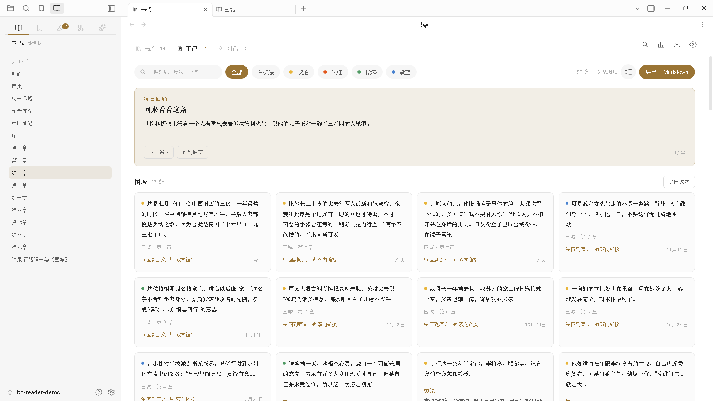

  
  <h1>bz Reader</h1>
  
<b>Mach Obsidian zu einem Ort, an dem du liest.</b> 
  Desktop + Mobil, mehrere Formate (inkl. PDF und Comics), mehrere Sprachen, KI-Rückfragen mit Anker / Fragen zum ganzen Buch / semantische Suche / Wissensdatenbank, Offline-Hörbücher, Wikilinks, Statistik – alle Daten bleiben lokal.

  

    
    
    
    
    
  

  

    
    
  

  
<a href="https://www.bilibili.com/video/BV1tK4E6KE1B">Video-Tutorial</a> · QQ-Gruppe 1130883117 · <a href="README.md#support">Autor unterstützen</a>

  
<a href="README.md">简体中文</a> · <a href="README.md#english">English</a> · <a href="README.zh-TW.md">繁體中文</a> · <a href="README.ja.md">日本語</a> · Deutsch · <a href="README.fr.md">Français</a> · <a href="README.es.md">Español</a> · <a href="README.pt.md">Português</a>

## Deutsch

Mach aus Obsidian einen Ort zum Lesen. Desktop + Mobil, mehrere Formate (inkl. PDF und Comics), mehrere Sprachen, KI-Rückfragen mit Anker / Fragen zum ganzen Buch / semantische Suche / Wissensdatenbank, Offline-Hörbücher, Wikilinks, Statistik – alle Daten bleiben lokal.

  

<b>Lesen · Notizen · Farben · Auswahlleiste · Fußnoten</b>

  

<b>Mobil · Regal · Lesen</b>

  
  &nbsp;&nbsp;
  

<b>KI · Verankerte Rückfragen · Fragen zum ganzen Buch</b>

  

<b>PDF · Zitate</b>

  

<b>Vorlesen · Satzweise Hervorhebung · Kapitel- / Buchvorbereitung</b>

  

<b>Notizen · Tägliche Wiederholung</b>

  

<b>Chats · Nach Buch gruppiert</b>

  

<b>Suche · Wörtlich / nach Bedeutung · Scan-Fortschritt · Nach Buch · Kapitelstellen</b>

  

<b>Statistik · Heute · Vergleich · Tägliche Zeit · Leserhythmus</b>

  

<b>Lese-Seitenleiste · Inhalt · Lesezeichen · Markierungen · Zitate · KI zum ganzen Buch</b>

  

### Installation

Installation über das Community-Verzeichnis (sichtbar, sobald die erste Prüfung durch ist):

1. **Einstellungen → Community-Plugins** öffnen und den eingeschränkten Modus ausschalten.
2. Auf **Durchsuchen** klicken, nach **bz Reader** suchen und installieren.
3. Aktivieren — links erscheint ein bz-Symbol; das Regal ist der Einstieg.

Solange die Prüfung läuft oder die Suche nichts findet: mit [BRAT](https://github.com/TfTHacker/obsidian42-brat) dieses Repository hinzufügen, oder `main.js`, `manifest.json` und `styles.css` aus dem Release herunterladen, nach `<dein Vault>/.obsidian/plugins/bz-reader/` legen und aktivieren.

### Funktionen

| Bereich | Funktion | Basis | Pro |
|---|:---|:---:|:---:|
| **Lesen & Regal** | EPUB / TXT sofort lesbar | ✓ | ✓ |
|  | Eine oder zwei Spalten | ✓ | ✓ |
|  | Inhalt, Lesezeichen, vier Markierungsfarben und Notizen | ✓ | ✓ |
|  | Suche im Buch | ✓ | ✓ |
|  | Zur vorherigen Stelle zurück – nach jedem Sprung ein Klick | ✓ | ✓ |
|  | Fußnoten im Pop-up – ohne die Seite zu verlassen | ✓ | ✓ |
|  | Zitatkarten als Bild | ✓ | ✓ |
|  | Regal-Kategorien | ✓ | ✓ |
| **Formate & Export** | Kindle-Familie (MOBI / AZW3), FB2, CBZ-Comics, PDF | — | ✓ |
|  | Markierungen als Wikilinks: aus der Notiz zur Stelle | — | ✓ |
|  | Zitate-Tab: welche Notizen dieses Buch zitieren | — | ✓ |
|  | Alle Exzerpte exportieren, jeweils mit Wikilink | — | ✓ |
| **PDF lesen** | PDF öffnen: zoomen, drehen, Einzel- / Doppelseite, Scrollen; Ansicht pro Buch | — | ✓ |
|  | Seitenminiaturen: auch in langen Büchern schnell finden | — | ✓ |
|  | Seitenlinks kopieren: Seite / Ansicht / Einbettung / Anmerkung | — | ✓ |
|  | Backlinks auf dieser Seite und Anmerkungen in der Datei | — | ✓ |
|  | Seite als Bild exportieren | — | ✓ |
|  | Gescannte Seiten erkennen: auswählen, suchen und markieren wie echter Text | — | ✓ |
| **Statistik & Suche** | Statistikpanel: Zeit, Verlauf, Rhythmus, Details je Buch | — | ✓ |
|  | Leseposter: Jahresrückblick und Daten-Langbild | — | ✓ |
|  | Bibliothek durchsuchen, PDF-Text inklusive | — | ✓ |
| **KI** | KI: erklären, übersetzen, zusammenfassen, nachfragen — direkt zur Auswahl | — | ✓ |
|  | KI: Fragen zum ganzen Buch — Markierungen, Seitentext, Screenshots und Notizen als Belege | — | ✓ |
|  | KI-Gespräche bleiben erhalten und lassen sich als Notiz exportieren | — | ✓ |
|  | KI-Begleiter: beim Lesen fragen, mit Kapitelführer | — | ✓ |
|  | KI-Wissensbasis: inkrementelles Lesen, Wissensinput und ein Kreislauf bis zur Ausgabe | — | ✓ |
| **Fortgeschritten** | Vertikaler Satz: EPUB / TXT | — | ✓ |
|  | Vorlesen: EPUB, TXT und PDF, blättert automatisch weiter | — | ✓ |
|  | Zwei Bücher nebeneinander lesen | — | ✓ |
|  | Buchübersicht | — | ✓ |
|  | PDF reflow: fixed layouts read as flowing text | — | — |
|  | Manga mode: panels, right-to-left, spreads | — | — |
|  | Chapter translation: source and translation side by side | — | — |
|  | Review: reread in full, with AI flashcards and quizzes | — | — |
|  | E Ink optimization: crisper black and white, no page-turn flashing | — | — |
|  | Interface motion: page turns, chapter changes and shelf transitions, can be turned off | — | — |
|  | Clipbook to EPUB: bind clipped articles into one EPUB and read it on the shelf | — | — |

### Oberflächensprachen

Die Oberfläche folgt der Sprache von Obsidian; unter **Regal → Einstellungen → Oberfläche** lässt sich eine von acht auch von Hand wählen: 简体中文, 繁體中文, English, 日本語, Deutsch, Français, Español, Português.

Die Umschaltung wirkt sofort auf die Oberfläche; Befehlsnamen erst nach einem Neustart von Obsidian. Traditionelles Chinesisch ist keine Glyphenumwandlung des Vereinfachten, sondern ein eigenes Paket mit Taiwan-Wortschatz (設定 / 預設 / 匯入 / 匯出 / 檔案). **Der Changelog ist die eine Ausnahme**: Er wird pro Release von Hand geschrieben und existiert nur auf Chinesisch und Englisch; die anderen sechs Sprachen zeigen die englischen Einträge.

### Pro-Funktionen

Die Basisversion ist kostenlos. Für die Pro-Funktionen braucht es einen Lizenzschlüssel; den aktuellen Preis nennt die [Kaufseite](https://wzyp.cn/shop/IFCEI5I3).

- Der Schlüssel wird unter **Regal → Einstellungen → Lizenz** eingetragen und lokal geprüft, ohne Netzwerkzugriff.
- Er ist an keine Gerätezahl gebunden — auf einem neuen Gerät einfach erneut eintragen.
- Ein Build deckt Desktop und Mobil ab; kein zweiter Kauf nötig.

### Wie KI funktioniert

- Jedes Buch hat lokal ein **Porträt** (Chunks plus Vektoren / Zusammenfassungen).
- Eine Frage läuft zuerst durch das **Routing**, dann durch die **hybride Suche**; nur Belege im Budget gelangen in den Prompt.
- Die Antwort kommt per SSE zurück und wird anschließend **zitiert geprüft**.

#### Warum die Einbettungen von bz kommen

- Das Plugin besteht aus drei Dateien (`main.js`, `manifest.json`, `styles.css`) und kann keine Modellgewichte oder Laufzeit mitbringen. Ein fest eingebautes kleines Modell würde die Suchgenauigkeit aller begrenzen.
- Die Einbettungsschicht liefert bz (Second Brain). Die Modellwahl liegt bei dir: ein schweres lokales Modell oder ein Cloud-Dienst. Mehr Rechenleistung erlaubt ein stärkeres Modell und genauere Treffer.
- Buchabschnitte und Notizen müssen im selben **Vektorraum** liegen. Wich der Modellname von bz ab, gab es früher **stillschweigend falsche Ergebnisse**.
- bz liefert und speichert den Modellnamen; bei einem Wechsel werden alte Porträts ungültig. Die Vektoren bleiben lokal in `portraits/`.

#### Porträt und Segmentierung

- `portraits/<Buch-ID>.json`: `plan / model / dim / chunkChars / overlap / blocks[] / overview / guides / done`; jeder Block enthält `chapter / vec / digest / summary / text`.
- Vektoren als base64-**Float32Array**, Kosinusähnlichkeit lokal, atomare Schreibvorgänge; Abfragevektoren mit **LRU**-Cache (50 Einträge).
- Segmentierung an Absatzgrenzen, mit Schnitt am Kapitelanfang.
- **A Vektorsuche**: 1000 Zeichen pro Chunk, 120 Überlappung, 8 Chunks pro Batch. **B Informationskompression**: 8000 Zeichen pro Chunk, vom Chat-Modell verdichtet, nicht Teil der Vektorsuche.
- Immer nur ein Buch, auf Mobilgeräten nicht verfügbar.

#### Hybride Suche und Re-Ranking

- **Literal-Kanal**: chinesische Bigramme mit **BM25** (k1 1.2 / b 0.75), Kapitelnamen-Feld gewichtet ×2.5.
- **Vektorkanal**: umformulierte Anfrage, Nachbarsuche, absolut 0.2 / relativ 0.6.
- **RRF-Rangfusion** (k = 60): Kosinus und BM25 sind nicht vergleichbar, daher werden Ränge statt Scores zusammengeführt.
- **Adaptive Eingrenzung**: floor 3 / ceiling 30 / rel 0.3 / abs 1e-4, nach Kapitel dedupliziert.
- **Nachbar-Erweiterung**: Chunks ±1 um die drei besten Kandidaten fließen mit Gewicht 0,85 ein; **Kapitelkopf-Kompensation** behält den ersten Chunk eines Trefferkapitels.
- **Budget**: Top 6 / 8000 Zeichen; buchübergreifende semantische Suche 3 pro Buch, 20 insgesamt.

#### Struktur-Routing, Generierung und Prüfung

- **Kapitelkarte**: eine Zeile pro Kapitel, Abschnittsnummern auf echte Namen aufgelöst, literal 3/1, „Kapitel N" als harte Bedingung, kein Modellaufruf.
- **Ganzkapitel-Lesen**: Inhaltsverzeichnis:Text 3:7, mindestens 600 Zeichen pro Kapitel, Kürzung markiert; bei Fragen zum ganzen Buch verteilt `bookSpread` Stichproben auf alle Kapitel.
- **Spoiler-Gate**: schneidet beim letzten Chunk des aktuellen Kapitels ab und leert die Übersicht; für alle drei Pfade und Follow-ups gemeinsam, standardmäßig aus.
- **Prompt**: 8000 Zeichen Belege plus die letzten 6 Runden; Zitate in 「」 mit Kapitelangabe.
- **SSE-Streaming**: `TextDecoder(stream:true)` für geteilte UTF-8-Zeichen, Timeout anhand der Byte-Abstände, 80 ms gedrosselte DOM-Aktualisierung, halbe Antworten bleiben erhalten.
- **Zitatprüfung**: Zitate mit 4–80 Zeichen werden mit den tatsächlich gesendeten Belegen abgeglichen (Bigramme ≥ 0,8), kurze Zitate müssen exakt stimmen; maximal 8 Quellen mit Sprung zur Stelle.

#### Reine KI ohne Index

- Erklären / Übersetzen / Zusammenfassen: nur die Auswahl wird gesendet (Zusammenfassung ≤100, Erklärung ≤120 Zeichen).
- Follow-up: Originaltext ≤2000 Zeichen plus optional 3 Chunks / 1200 Zeichen; Anfrage = 120 Zeichen vor der Markierung + aktuelle Frage.
- Seitenleisten-Kontext: 1200 Zeichen pro Element, 6000 insgesamt.

### Gescannte PDF: Markieren und Suchen

- **OCR**: Das Menü „Gescannte Seiten erkennen" bietet diese Seite / nächste 20 / ganzes Buch / fehlgeschlagene Seiten erneut. Sequenziell, 20 Seiten pro Batch. Vision-Modell oder eigener / LAN-OCR-Dienst (mobil nur Vision). Ganzbuch läuft wegen Seitenabrechnung mit einer Bestätigung.
- **Ergebnis**: Eine JSON-Datei pro Buch, standardmäßig `bz-reader/storage/ocr/<Buch-ID>.json` (Datenordner änderbar); die PDF bleibt unberührt. Ergebnisse überstehen Neustarts; fehlgeschlagene Seiten bleiben für die Wiederholung, es gibt keine automatische Wiederholung.
- **Textschicht**: Erkannte Zeilen liegen als transparente, auswählbare Schicht über dem Scan. Nur Seiten mit Linienrahmen erlauben Textauswahl; reine Textseiten sind les- und suchbar, aber nicht auswählbar.
- **Markierungen**: OCR-Seiten nutzen dieselben Markierungen, vier Farben, Notizen und Wikilinks wie normale PDFs; Anker ist „Seite + Zeichenoffset in der Textschicht". Ohne Textschicht wird ein Rechteck ausgewählt, mit Notizen, Links und Zitatkarten-Export; Zitattext setzt OCR voraus.
- **Suche**: Die Suche über alle Bücher und innerhalb der PDF liest die JSON direkt, ohne Index-Neuaufbau. Treffer springen zur Seite und zeichnen Rechtecke auf der Textschicht; 40 Markierungen pro Seite, 300 Treffer insgesamt, 50 pro Buch.
- **Semantische Suche**: braucht ein Porträt. Dessen Text stammt aus dem OCR pro Seite, also muss **zuerst** erkannt werden; später erkannte Seiten erfordern einen Neuaufbau. Das Porträt muss fertig sein und der Einbettungsmodellname übereinstimmen. Semantische Treffer haben keinen genauen Anker, beim Öffnen läuft daher eine Textsuche mit dem Snippet.

### Vorlesen: So funktioniert es

- **Text**: EPUB / TXT nutzen den sichtbaren Abschnitt oder ein ganzes Kapitel; PDF liest nur die Textschicht der aktuellen Seite, gescannte Seiten brauchen zuvor OCR, PDF hat keine Kapitel-Vorbereitung.
- **Drei Engines**: Systemstimme (offline, kein Cache, kein Prefetch), Online (offizieller oder OpenAI-kompatibler Endpunkt), eigener Sprachdienst. TTS-Einstellungen sind von den KI-Einstellungen getrennt; mobil ist Online zwingend.
- **Satztrennung**: Erzählung und Dialog trennen, dann an Satzzeichen schneiden; Ziel 240 Zeichen, längere Sätze weichen auf Kommas aus, kurze Fragmente werden zusammengeführt, reine Symbole nicht vorgelesen. Systemstimme: 220 / 4000 Zeichen.
- **Wiedergabe**: Satz für Satz, automatischer Weiterlauf; 3 Sätze Prefetch (eigener Dienst bereitet das ganze Kapitel vor), höchstens 2 Anfragen gleichzeitig; Positionswechsel bricht nur veraltete Anfragen ab. Abgelehnte Sätze werden übersprungen, Prefetch-Fehler einmal still wiederholt, andere Fehler stoppen mit „Weiterhören".
- **Cache**: Schlüssel aus Buch + Engine + Modell + Stimme + Text, lokal gespeichert; Treffer aktualisieren nur den Zeitstempel. Standard 300 MB, einstellbar bis 2 GB.
- **Hervorhebung**: Online und lokal wird jeder Satz über Anker im Text markiert, nicht über Sprachereignisse oder Timer; offline ganze Kapitel nutzen eine Zeitachse, die Systemstimme den Start-Callback.
- **Vorbereitung**: Kapitel-Audio wird zu einer Datei zusammengefügt, mit einer Liste aus Zeiten und Byte-Bereichen je Satz; atomare Schreibweise und Rückleseprüfung. Sechs Zustände (Warteschlange / Synthese / Paketieren / Fertig / Abgebrochen / Fehler), keine Zeitprognose, Stopp wirkt an Satzgrenzen; der Cache ist der Fortschritt und kann fortgesetzt oder neu gebaut werden. Kapitel ist Pro, ganzes Buch nur mit lokaler Engine, nicht auf Mobilgeräten.
- **Offline-Hören**: Den ganzen Ordner (Audio + Manifest) in `bz-reader/offline/` innerhalb des Vaults ablegen. Nur eine Ebene wird gescannt, zuerst nach Buchtitel, dann nach Buch-ID; reine mp3-Dateien werden nicht gefunden. Die Wiedergabe schneidet nach Byte-Bereichen oder spielt das ganze Kapitel mit Zeitachse; geänderter Text wird neu ausgerichtet, danach geht es automatisch weiter.
- **Fortsetzen**: Nur die letzte Position wird beim Stopp lokal gespeichert, auf Satzesebene. Wiederherstellung: gleiches Kapitel mit Offset → ganzes Kapitel durchsuchen → Seitenanfang. Wechselt das Gerät, bleibt die Position zurück.

### Netzwerkzugriff

Nur die KI-Funktionen und die Unterstützerliste in „Den Autor unterstützen“ gehen online; alles andere arbeitet vollständig offline.

- Anfragen gehen an den OpenAI-kompatiblen Endpunkt, den du einstellst (eigener Server oder Drittanbieter-API). Das Plugin hat keinen eigenen Server.
- Beim Aufbau des Buchindex wird der Buchtext in Blöcken an deinen Embedding-Dienst geschickt; eine Frage sendet nur die wenigen gefundenen Blöcke, bei Bedarf plus Buchtitel, Kapitelname und die letzten Gesprächsrunden. Vektoren und Index bleiben im Plugin-Ordner und werden nicht hochgeladen.
- Die Embeddings liefert das bz-Plugin (zweites Gehirn): ohne es gibt es keine Vektorsuche, nur den Weg über verdichtete Kernpunkte.
- Der API-Schlüssel liegt mit den übrigen Einstellungen in `data.json` im Plugin-Ordner. Er geht nie an den Autor, sondern nur als Request-Header an den von dir eingestellten Endpunkt.
- Beim Öffnen von „Den Autor unterstützen“ (oder des Änderungsprotokolls) wird eine öffentliche Unterstützerliste geladen: dieselbe statische JSON-Datei von GitHub und Gitee gleichzeitig, die zuerst antwortet, gewinnt. Es wird nur diese Liste abgerufen – keine persönlichen Daten, keine Statistik. Die Liste wird lokal zwischengespeichert; sind beide Quellen nicht erreichbar, erscheint „Liste konnte nicht geladen werden“ mit einem erneuten Versuch. Die Liste ist öffentlich und in beiden Plugins identisch.

### Häufige Fragen

- **Welche Formate?** EPUB und TXT sofort; mobi, azw3, fb2, Comics und PDF mit Pro.
- **Kollidiert es mit anderen Plugins?** Die Leseansicht ist eine native Obsidian-Ansicht, der Inhalt ein Tab in der linken Seitenleiste. Markierungen lassen sich als Markdown-Links mit Positionsangabe kopieren, die zur genauen Stelle zurückspringen — ein eigener Index wird nicht angelegt.
- **Rechnerwechsel?** Der Vault nimmt Regal, Fortschritt und Anmerkungen mit. Den Lizenzschlüssel auf dem neuen Gerät erneut eingeben.
- **Muss ich mobil noch einmal zahlen?** Nein. Ein Build deckt Desktop und Mobil ab.

### Empfohlene Plugins

- [bz](https://github.com/yeshimei/bz) — Tagebuch, Notizen, Sammlungen, Besitztümer, Bücher und Filme, Spiele, Web-Clips, Pomodoro, Wiederholung, sichere Verschlüsselung (Passwortbuch + Tresor), KI-Wissensbasis (Wissensboxen + zweites Gehirn), Tool-Dock und eine Desktop-Katze.
- [bz Review](https://github.com/yeshimei/bz-review) — bz review lässt die KI Karten erstellen und ordnen, damit du dich aufs Lesen und Wiederholen konzentrierst. FSRS plant die Wiederholungen nach Gedächtnisstabilität und passt die Parameter an deine eigene Historie an – weniger Wiederholungen, besser im Gedächtnis.

### Lizenz

Veröffentlicht unter der [MIT](LICENSE)-Lizenz. Die Rendering-Engine ist [foliate-js](https://github.com/johnfactotum/foliate-js) 1.0.1 (MIT, als npm-Abhängigkeit verteilt; lokale Patches in [patches/foliate-js@1.0.1.patch](patches/foliate-js@1.0.1.patch)).
