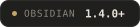
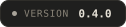
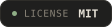
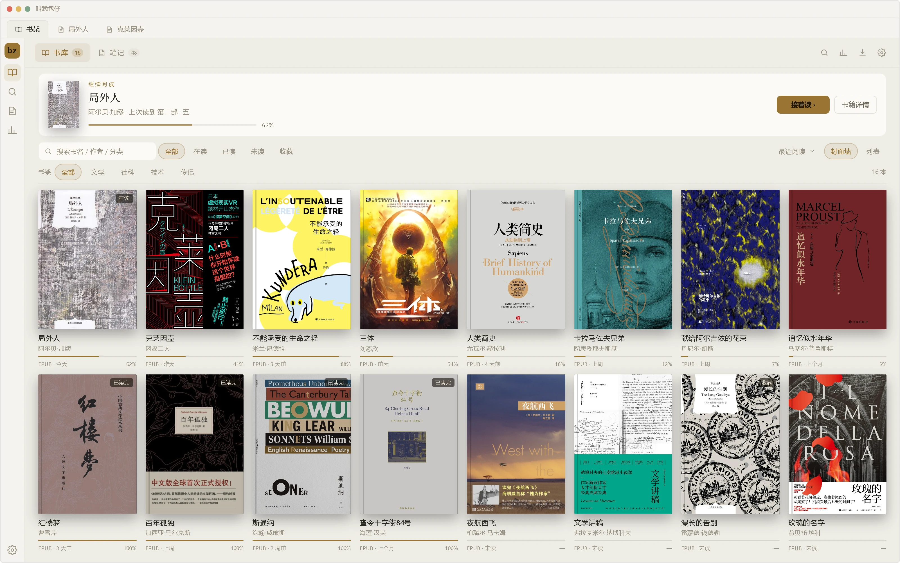
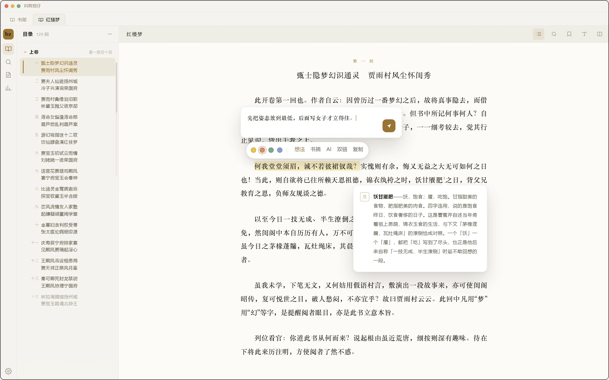
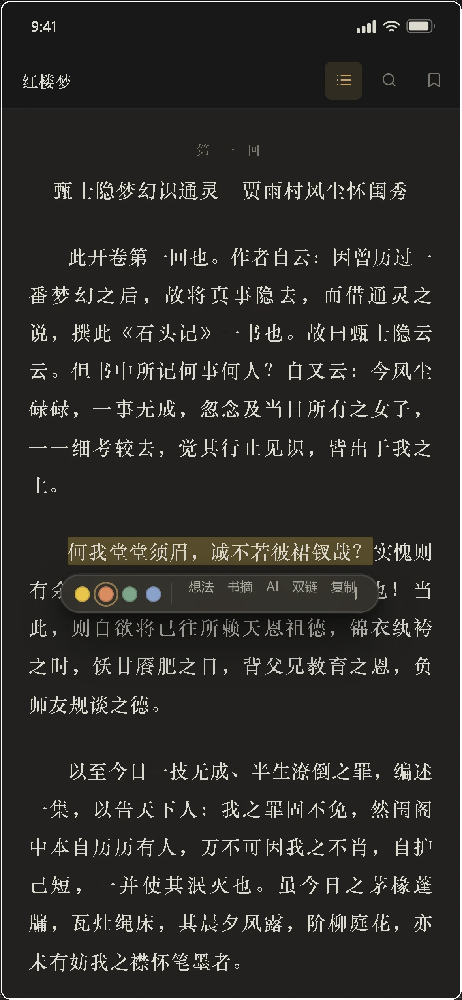

  
  <h1>bz Reader</h1>
  
<b>Turn Obsidian into a place to read.</b> 
  Desktop and mobile, multiple formats, AI, source links. No network required.

  

    
    
    
    
  

  
<a href="README.md">简体中文</a>

  

  

  
  &nbsp;&nbsp;
  

## Features

| | Free | Pro |
|---|:---:|:---:|
| EPUB / TXT reading, pagination, and typography | ✓ | ✓ |
| Contents, bookmarks, four-color highlights, and notes | ✓ | ✓ |
| In-book search | ✓ | ✓ |
| Footnote preview in a popover | ✓ | ✓ |
| Copy highlights as source links | — | ✓ |
| Structured Markdown export | — | ✓ |
| Highlight cards | — | ✓ |
| Reading stats, heatmap, and per-book progress | — | ✓ |
| Cross-book search | — | ✓ |
| AI summary / explanation / translation | — | ✓ |
| mobi / azw3 / fb2 / comics | — | ✓ |
| Vertical and two-column layout | — | ✓ |
| Text-to-speech | — | ✓ |
| Original and translation side by side | — | ✓ |
| Book map | — | ✓ |

Enter your license key in **Shelf → Settings → 授权 (License)** to unlock — verified locally, no network required.

## FAQ

- **Which formats?** EPUB and TXT out of the box; mobi, azw3, fb2, and comics with Pro.
- **Does it conflict with other plugins?** The reader is a native Obsidian view and the contents are a tab in the left sidebar. Highlights can be copied as locator Markdown links that jump back to the exact passage — no separate index is built.
- **Switching computers?** Your vault carries the shelf, progress, and annotations. Re-enter the license key on the new device.
- **Do I pay again on mobile?** No. One build covers desktop and mobile.

## Installation

1. Open **Settings → Community plugins** and turn off Restricted mode.
2. Click **Browse**, search for **bz Reader**, and install.
3. Enable it — a bz icon appears in the left ribbon; start from the shelf.

## License

Released under the [MIT](LICENSE) license. The rendering engine is [foliate-js](https://github.com/johnfactotum/foliate-js) 1.0.1 (MIT).
