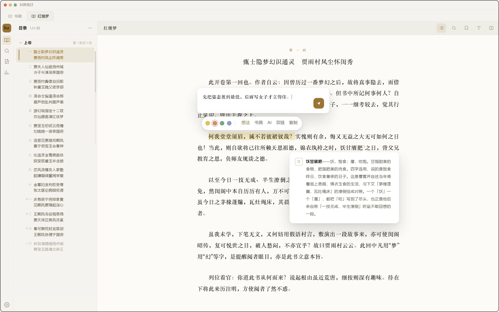

  
  <h1>bz Reader</h1>
  
<b>把 Obsidian 变成一个能读书的地方。</b> 
  桌面端 + 移动端、多格式（包括 PDF），多语言支持、AI 全书问答、双向链接，数据全部本地。

  

    
    
    
    
    
    
  

  
<a href="https://www.bilibili.com/video/BV1tK4E6KE1B">视频教程</a> · QQ 群 1130883117 · <a href="#support">支持作者</a>

  
<b>简体中文</b> · <a href="#english">English</a> · <a href="#繁體中文">繁體中文</a> · <a href="#日本語">日本語</a> · <a href="#deutsch">Deutsch</a> · <a href="#français">Français</a> · <a href="#español">Español</a> · <a href="#português">Português</a>

  

  

  
  &nbsp;&nbsp;
  

## 安装

在社区市场安装（首次上架审核通过后可见）：

1. 打开 **设置 → 第三方插件**，关闭安全模式。
2. 点 **浏览**，搜索 **bz Reader**，安装。
3. 启用后左侧出现 bz 图标，从书架开始。

审核期间或搜不到时，用 [BRAT](https://github.com/TfTHacker/obsidian42-brat) 添加本仓库安装，或手动下载 Release 里的 `main.js`、`manifest.json`、`styles.css`，放进 `<你的库>/.obsidian/plugins/bz-reader/` 后启用。

## 功能

| 类别 | 功能 | 基础版 | 高级版 |
|---|:---|:---:|:---:|
| **阅读与书架** | EPUB / TXT 打开即读 | ✓ | ✓ |
|  | 单栏 / 双栏 | ✓ | ✓ |
|  | 目录、书签、四色划线、想法 | ✓ | ✓ |
|  | 书内搜索 | ✓ | ✓ |
|  | 回到上一处：跳走之后一键回来 | ✓ | ✓ |
|  | 脚注浮窗：小注不用离页 | ✓ | ✓ |
|  | 划线做成书摘图片 | ✓ | ✓ |
|  | 分类管理 | ✓ | ✓ |
| **格式与导出** | Kindle 系（MOBI / AZW3）、FB2、CBZ 漫画、PDF | — | ✓ |
|  | 划线存成双链：笔记里点回原文 | — | ✓ |
|  | 引用页签：看哪些笔记引了这本书 | — | ✓ |
|  | 导出整本摘录：每条带双链 | — | ✓ |
| **PDF 阅读** | 打开 PDF：缩放、旋转、单双页、滚动，每本记住视角 | — | ✓ |
|  | 页缩略图：几百页也能一屏找 | — | ✓ |
|  | 复制页链接：页码 / 视图 / 嵌入 / 批注 | — | ✓ |
|  | 本页反链与文件自带批注 | — | ✓ |
|  | 导出本页为图片 | — | ✓ |
| **统计与检索** | 数据面板：时长、趋势、节律、书籍明细 | — | ✓ |
|  | 阅读海报：年度总结与数据长图 | — | ✓ |
|  | 全库搜索：PDF 正文也搜得到 | — | ✓ |
|  | 语义搜索：本书与全库，按意思找 | — | ✓ |
| **AI** | AI 解释、翻译与摘要：划词即用 | — | ✓ |
|  | AI 全书问答 | — | ✓ |
|  | AI 伴读：边读边问，按章导读 | — | ✓ |
| **进阶** | 竖排排版：EPUB / TXT | — | ✓ |
|  | 朗读：EPUB、TXT 与 PDF，念完自动翻页 | — | ✓ |
|  | 与另一本书并排对照 | — | ✓ |
|  | 全书鸟瞰 | — | ✓ |
|  | 连接 BZ AI 知识库（需另装 bz） | — | ✓ |
|  | 剪藏成书：把剪藏本的文章合成 EPUB，在书架里读 | — | ✓ |
| **探索中** | PDF OCR+AI视觉：扫描件像文字版一样能选能搜能划 | — | — |
|  | PDF 重排：固定版式也能流式读 | — | — |
|  | 漫画模式：分格、右到左、跨页 | — | — |
|  | 整章翻译：原文译文对照读 | — | — |
|  | 复习：全文回顾，AI 生成抽认卡与题目 | — | — |
|  | 墨水屏优化：黑白更清、翻页不闪 | — | — |
|  | 界面动效：翻页、切章与书架过渡，可随时关 | — | — |

## 界面语言

界面跟着 Obsidian 的语言走，也可以在 **书架 → 设置 → 界面** 里手动指定：简体中文、繁體中文、English、日本語、Deutsch、Français、Español、Português。

切换后界面立即生效；命令名需重启 Obsidian 才更新。繁体不是简体的字形转换，是另一套台湾用语（設定 / 預設 / 匯入 / 匯出 / 檔案）。**更新日志是唯一的例外**：它每次发版手写，只做中文与英文两版，其余六种语言显示英文条目。

## 付费说明

基础版免费。高级版需要付费购买激活码：[购买页面](https://wzyp.cn/shop/IFCEI5I3)，具体价格以该页面为准。

- 激活码在 **书架 → 设置 → 授权** 里填入，本地验签，不联网。
- 不绑定设备数：换电脑或手机时，在新设备的同一位置再填一次即可。
- 桌面端与移动端是同一个包，买一次两边都能用。

## 网络访问

只有 AI 功能与「支持作者」名单会联网，其余功能完全离线。

- AI 请求发往你在设置里填写的 OpenAI 兼容接口（自建服务或第三方 API 均可），插件没有自己的服务器。
- 建全书索引时，整本书的正文会分块发给嵌入服务；提问时只发检索命中的那几块，必要时再带上书名、章节名与最近几轮问答。向量与索引都存在插件目录里，不上传。
- 嵌入由 bz（第二大脑）插件提供：没装它就没有向量检索，只能走压缩要点那一档。
- API Key 与其他设置一起保存在插件目录的 `data.json` 里，不会上传给插件作者；只有请求你自己填写的那个接口时，它才会以请求头的形式发过去。
- 打开「支持作者」弹窗（或更新日志）时，会读取一份公开的支持者名单：同时请求 GitHub 与码云上的同一个静态 JSON，谁先回用谁。只取这一份名单，不发送任何个人信息、不做统计上报；名单在本机缓存，两个源都不通时显示「没加载出来」和重试。名单是公开数据，内容与两个插件里显示的完全一致。

## 常见问题

- **支持哪些格式？** EPUB 与 TXT 开箱即读；mobi、azw3、fb2、漫画与 PDF 在高级版。
- **会和其他插件打架吗？** 阅读页是 Obsidian 原生视图，目录是左侧栏里的一个页签；划线可以复制成带定位的 Markdown 链接，点一下跳回原文那一句，不另建索引。
- **换电脑怎么办？** 库同步过去，书架、进度和标注跟着走；高级版在新设备上重新填一次激活码。
- **手机上要单独买吗？** 不用，同一个包，桌面与移动都包含在内。

## 插件推荐

- [bz](https://github.com/yeshimei/bz) —— 日记、备忘、读书观影、游戏、剪藏、番茄钟，复习、安全加密，ai知识库，工具坞，还有一只桌宠猫

## 支持作者

  

微信扫一扫，请作者喝杯咖啡

插件的开发、维护和教程视频都是作者一个人在做。

打赏后会出现在 bz 所有插件的感谢名单里（插件里走 设置 → 支持作者 就能看到）。

**成为赞助人：[点击这里](https://wzyp.cn/shop/IFCEI5I3)**

## 许可

本项目以 [MIT](LICENSE) 许可发布。渲染内核来自 [foliate-js](https://github.com/johnfactotum/foliate-js) 1.0.1（MIT，以 npm 依赖分发，本地补丁见 [patches/foliate-js@1.0.1.patch](patches/foliate-js@1.0.1.patch)）。

---

## English

### Installation

Install from the community directory (visible once the initial review passes):

1. Open **Settings → Community plugins** and turn off Restricted mode.
2. Click **Browse**, search for **bz Reader**, and install.
3. Enable it — a bz icon appears in the left ribbon; start from the shelf.

While the review is pending, or if search doesn't find it, install with [BRAT](https://github.com/TfTHacker/obsidian42-brat), or download `main.js`, `manifest.json`, and `styles.css` from the Release and place them in `<your vault>/.obsidian/plugins/bz-reader/`, then enable the plugin.

### Features

| Group | Feature | Free | Pro |
|---|:---|:---:|:---:|
| **Reading & Shelf** | EPUB / TXT, open and read | ✓ | ✓ |
|  | One or two columns | ✓ | ✓ |
|  | Contents, bookmarks, four-color highlights, notes | ✓ | ✓ |
|  | In-book search | ✓ | ✓ |
|  | Back to your previous spot: one tap after any jump | ✓ | ✓ |
|  | Footnotes in a popover: no need to leave the page | ✓ | ✓ |
|  | Highlights as quote card images | ✓ | ✓ |
|  | Shelf categories | ✓ | ✓ |
| **Formats & Export** | Kindle family (MOBI / AZW3), FB2, CBZ comics, PDF | — | ✓ |
|  | Highlights as wikilinks: click back from your notes | — | ✓ |
|  | Citations tab: see which notes cite this book | — | ✓ |
|  | Export every excerpt, each with a wikilink | — | ✓ |
| **PDF Reading** | Open a PDF: zoom, rotate, one or two pages, scroll; view remembered per book | — | ✓ |
|  | Page thumbnails: find a page in a long book | — | ✓ |
|  | Copy page links: page / view / embed / annotation | — | ✓ |
|  | Backlinks on this page and annotations in the file | — | ✓ |
|  | Export a page as an image | — | ✓ |
| **Stats & Search** | Stats panel: time, trends, rhythm, per-book detail | — | ✓ |
|  | Reading poster: yearly recap and stats long image | — | ✓ |
|  | Whole-library search, PDF text included | — | ✓ |
|  | Semantic search: by meaning, in this book or the shelf | — | ✓ |
| **AI** | Explain, translate, summarize a selection | — | ✓ |
|  | AI Q&A over the whole book | — | ✓ |
|  | AI companion: ask as you read, with a per-chapter guide | — | ✓ |
| **Advanced** | Vertical typesetting: EPUB / TXT | — | ✓ |
|  | Read aloud: EPUB, TXT and PDF, auto page-turn | — | ✓ |
|  | Read two books side by side | — | ✓ |
|  | Book overview | — | ✓ |
|  | Connect to the BZ AI knowledge base (requires bz) | — | ✓ |
| **Explorations** | PDF OCR + AI vision: scanned pages work like text — select, search, highlight | — | — |
|  | PDF reflow: fixed layouts read as flowing text | — | — |
|  | Manga mode: panels, right-to-left, spreads | — | — |
|  | Chapter translation: source and translation side by side | — | — |
|  | Review: reread in full, with AI flashcards and quizzes | — | — |
|  | E Ink optimization: crisper black and white, no page-turn flashing | — | — |
|  | Interface motion: page turns, chapter changes and shelf transitions, can be turned off | — | — |
|  | Clipbook to EPUB: bind clipped articles into one EPUB and read it on the shelf | — | — |

### Interface languages

The interface follows Obsidian's language, and you can also pick one of eight by hand under
**Shelf → Settings → Interface**: 简体中文, 繁體中文, English, 日本語, Deutsch, Français,
Español, Português.

The switch applies to the interface immediately; command names update after restarting Obsidian
(the host registers them at load time). Traditional Chinese is not a glyph conversion of
Simplified — it is a separate pack using Taiwan vocabulary (設定 / 預設 / 匯入 / 匯出 / 檔案).
**The changelog is the one exception**: it is written by hand for each release and exists only in
Chinese and English; the other six languages show the English entries.

### Paid features

The free edition covers everyday reading. Pro features require a paid license key; see the [purchase page](https://wzyp.cn/shop/IFCEI5I3) for the current price.

- Enter the key in **Shelf → Settings → License**. It is verified locally, with no network call.
- Keys are not tied to a device count — just enter yours again on a new device.
- One build covers desktop and mobile — no separate purchase.

### Network access

Only the AI features and the supporter list in **Support the author** go online; everything else works fully offline.

- Requests go to the OpenAI-compatible endpoint you configure (your own server or a third-party API). The plugin has no server of its own.
- Building the whole-book index sends the book's text to your embedding service in chunks; a question only sends the few retrieved chunks, plus the book title, chapter name, and the last few turns when needed. Vectors and the index stay in the plugin folder and are never uploaded.
- Embeddings come from the bz (second brain) plugin: without it there is no vector search, only the compressed-key-points path.
- Your API key is stored with the rest of your settings in `data.json` inside the plugin folder. It is never sent to the plugin author; it only travels to the endpoint you configured, as a request header.
- Opening **Support the author** (or the changelog) reads a public supporter list: the same static JSON from GitHub and Gitee is requested at the same time, and whichever answers first is used. Only that list is fetched — no personal data, no analytics. It is cached locally; if both sources fail, "couldn't load" and a retry button appear. The list is public data, identical in both plugins.

### FAQ

- **Which formats?** EPUB and TXT out of the box; mobi, azw3, fb2, comics, and PDF with Pro.
- **Does it conflict with other plugins?** The reader is a native Obsidian view and the contents are a tab in the left sidebar. Highlights can be copied as locator Markdown links that jump back to the exact passage — no separate index is built.
- **Switching computers?** Your vault carries the shelf, progress, and annotations. Re-enter the license key on the new device.
- **Do I pay again on mobile?** No. One build covers desktop and mobile.

### Recommended plugins

- [bz](https://github.com/yeshimei/bz) — Diary, memos, books and films, games, web clippings, pomodoro, review, secure encryption, AI knowledge base, tool dock, and a desktop pet cat.

### License

Released under the [MIT](LICENSE) license. The rendering engine is [foliate-js](https://github.com/johnfactotum/foliate-js) 1.0.1 (MIT, distributed as an npm dependency; local patches in [patches/foliate-js@1.0.1.patch](patches/foliate-js@1.0.1.patch)).

---

<b>繁體中文</b>

## 繁體中文

把 Obsidian 變成一個能讀書的地方。桌面端 + 行動端、多格式（包括 PDF）、多語言支援、AI 全書問答、雙向連結，資料全部本地。

### 安裝

在社群市集安裝（首次上架審核通過後可見）：

1. 開啟 **設定 → 第三方外掛**，關閉安全模式。
2. 點 **瀏覽**，搜尋 **bz Reader**，安裝。
3. 啟用後左側出現 bz 圖示，從書架開始。

審核期間或搜不到時，用 [BRAT](https://github.com/TfTHacker/obsidian42-brat) 加入本倉庫安裝，或手動下載 Release 裡的 `main.js`、`manifest.json`、`styles.css`，放進 `<你的庫>/.obsidian/plugins/bz-reader/` 後啟用。

### 功能

| 類別 | 功能 | 基礎版 | 高級版 |
|---|:---|:---:|:---:|
| **閱讀與書架** | EPUB / TXT 開啟即讀 | ✓ | ✓ |
|  | 單欄 / 雙欄 | ✓ | ✓ |
|  | 目錄、書籤、四色劃線、想法 | ✓ | ✓ |
|  | 書內搜尋 | ✓ | ✓ |
|  | 回到上一處：跳走之後一鍵回來 | ✓ | ✓ |
|  | 腳註浮窗：小註不用離頁 | ✓ | ✓ |
|  | 劃線做成書摘圖片 | ✓ | ✓ |
|  | 分類管理 | ✓ | ✓ |
| **格式與匯出** | Kindle 系（MOBI / AZW3）、FB2、CBZ 漫畫、PDF | — | ✓ |
|  | 劃線存成雙鏈：筆記裡點回原文 | — | ✓ |
|  | 引用頁籤：看哪些筆記引用了本書 | — | ✓ |
|  | 匯出整本摘錄：每條帶雙鏈 | — | ✓ |
| **PDF 閱讀** | 開啟 PDF：縮放、旋轉、單雙頁、捲動，每本記住視角 | — | ✓ |
|  | 頁縮圖：幾百頁也能一屏找 | — | ✓ |
|  | 複製頁連結：頁碼 / 檢視 / 嵌入 / 批註 | — | ✓ |
|  | 本頁反鏈與檔案自帶批註 | — | ✓ |
|  | 匯出本頁為圖片 | — | ✓ |
| **統計與搜尋** | 資料面板：時長、趨勢、節律、書籍明細 | — | ✓ |
|  | 閱讀海報：年度總結與資料長圖 | — | ✓ |
|  | 全庫搜尋：PDF 正文也搜得到 | — | ✓ |
| **AI** | AI 解釋、翻譯與摘要：劃詞即用 | — | ✓ |
|  | AI 全書問答 | — | ✓ |
| **進階** | 豎排排版：EPUB / TXT | — | ✓ |
|  | 朗讀：EPUB、TXT 與 PDF，念完自動翻頁 | — | ✓ |
|  | 與另一本書並排對照 | — | ✓ |
|  | 全書鳥瞰 | — | ✓ |
|  | 連接 BZ AI 知識庫（需另裝 bz） | — | ✓ |
|  | 剪藏成書：把剪藏本的文章合成 EPUB，在書架裡讀 | — | ✓ |
| **探索中** | PDF OCR+AI視覺：掃描件像文字版一樣能選能搜能劃 | — | — |
|  | PDF 重排：固定版式也能流式讀 | — | — |
|  | 漫畫模式：分格、右到左、跨頁 | — | — |
|  | 整章翻譯：原文譯文對照讀 | — | — |
|  | 複習：全文回顧，AI 生成抽認卡與題目 | — | — |
|  | 墨水屏優化：黑白更清、翻頁不閃 | — | — |
|  | 介面動效：翻頁、切章與書架過渡，可隨時關 | — | — |

### 介面語言

介面跟著 Obsidian 的語言走，也可以在 **書架 → 設定 → 介面** 裡手動指定：简体中文、繁體中文、English、日本語、Deutsch、Français、Español、Português。

切換後介面立即生效；指令名稱需重新啟動 Obsidian 才更新。繁體不是簡體的字形轉換，是另一套台灣用語（設定 / 預設 / 匯入 / 匯出 / 檔案）。**更新日誌是唯一的例外**：它每次發版手寫，只做中文與英文兩版，其餘六種語言顯示英文條目。

### 付費說明

基礎版免費。高級版需要付費購買啟用碼：[購買頁面](https://wzyp.cn/shop/IFCEI5I3)，具體價格以該頁面為準。

- 啟用碼在 **書架 → 設定 → 授權** 裡填入，本地驗簽，不連網。
- 不綁定裝置數：換電腦或手機時，在新裝置的同一位置再填一次即可。
- 桌面端與行動端是同一個包，買一次兩邊都能用。

### 網路存取

只有 AI 功能與「支持作者」名單會連網，其餘功能完全離線。

- 請求發往你在設定裡填寫的 OpenAI 相容介面（自建服務或第三方 API 均可），外掛沒有自己的伺服器。
- 建全書索引時，整本書的正文會分塊發給嵌入服務；提問時只發檢索命中的那幾塊，必要時再帶上書名、章節名與最近幾輪問答。向量與索引都存在外掛目錄裡，不上傳。
- 嵌入由 bz（第二大腦）外掛提供：沒裝它就沒有向量檢索，只能走壓縮要點那一檔。
- API 金鑰與其他設定一起保存在外掛目錄的 `data.json` 裡，不會上傳給外掛作者；只有請求你自己填寫的那個介面時，它才會以請求標頭的形式送過去。
- 打開「支持作者」視窗（或更新日誌）時，會讀取一份公開的支援者名單：同時請求 GitHub 與碼雲上的同一個靜態 JSON，誰先回用誰。只取這一份名單，不發送任何個人資訊、不做統計上報；名單會快取在本機，兩個來源都不通時顯示「名單沒載入出來」和重試。名單是公開資料，內容與兩個外掛裡顯示的完全一致。

### 常見問題

- **支援哪些格式？** EPUB 與 TXT 開箱即讀；mobi、azw3、fb2、漫畫與 PDF 在高級版。
- **會和其他外掛衝突嗎？** 閱讀頁是 Obsidian 原生檢視，目錄是左側欄裡的一個頁籤；劃線可以複製成帶定位的 Markdown 連結，點一下跳回原文那一句，不另建索引。
- **換電腦怎麼辦？** 庫同步過去，書架、進度與標註跟著走；高級版在新裝置上重新填一次啟用碼。
- **手機上要單獨買嗎？** 不用，同一個包，桌面與行動都包含在內。

### 外掛推薦

- [bz](https://github.com/yeshimei/bz) —— 日記、備忘、讀書觀影、遊戲、剪藏、番茄鐘，複習、安全加密，AI 知識庫，工具塢，還有一隻桌寵貓

### 授權

本專案以 [MIT](LICENSE) 授權發布。渲染內核來自 [foliate-js](https://github.com/johnfactotum/foliate-js) 1.0.1（MIT，以 npm 依賴分發，本地補丁見 [patches/foliate-js@1.0.1.patch](patches/foliate-js@1.0.1.patch)）。

<b>日本語</b>

## 日本語

Obsidian を「本を読む場所」に。デスクトップ + モバイル、複数フォーマット（PDF を含む）、多言語対応、AI 全書 Q&A、双方向リンク。データはすべてローカル。

### インストール

コミュニティディレクトリからインストールします（初回審査の通過後に表示されます）。

1. **設定 → コミュニティプラグイン** を開き、制限モードを解除します。
2. **閲覧** をクリックし、**bz Reader** を検索してインストールします。
3. 有効にすると左リボンに bz アイコンが現れます。本棚から始めてください。

審査中で見つからない場合は、[BRAT](https://github.com/TfTHacker/obsidian42-brat) でこのリポジトリを追加するか、Release から `main.js`・`manifest.json`・`styles.css` をダウンロードして `<保管庫>/.obsidian/plugins/bz-reader/` に置き、有効化してください。

### 機能

| 区分 | 機能 | ベーシック版 | プロ版 |
|---|:---|:---:|:---:|
| **読書と本棚** | EPUB / TXT をすぐ読める | ✓ | ✓ |
|  | 1 段 / 2 段組 | ✓ | ✓ |
|  | 目次・ブックマーク・4 色ハイライトとメモ | ✓ | ✓ |
|  | 本文内検索 | ✓ | ✓ |
|  | 前の位置に戻る：移動したあとワンタップで戻れる | ✓ | ✓ |
|  | 脚注ポップアップ：ページを離れずに読める | ✓ | ✓ |
|  | 引用カード画像 | ✓ | ✓ |
|  | カテゴリ管理 | ✓ | ✓ |
| **形式と書き出し** | Kindle 系（MOBI / AZW3）、FB2、CBZ コミック、PDF | — | ✓ |
|  | ハイライトを双方向リンクに：ノートから原文へ | — | ✓ |
|  | 引用タブ：この本を引用したノート | — | ✓ |
|  | 抜粋をまとめて書き出し、各項目に双方向リンク | — | ✓ |
| **PDF を読む** | PDF を開く：ズーム・回転・見開き・スクロール、本ごとに表示を記憶 | — | ✓ |
|  | ページサムネイル：長い本でも一画面で探せる | — | ✓ |
|  | ページリンクをコピー：ページ / ビュー / 埋め込み / 注釈 | — | ✓ |
|  | このページへの被リンクとファイル内の注釈 | — | ✓ |
|  | このページを画像として書き出す | — | ✓ |
| **統計と検索** | データパネル：時間・推移・リズム・書籍別の内訳 | — | ✓ |
|  | 読書ポスター：年間まとめとデータ長画像 | — | ✓ |
|  | ライブラリ全体を検索：PDF 本文も対象 | — | ✓ |
| **AI** | AI 解説・翻訳・要約：選択するだけ | — | ✓ |
|  | AI 全書 Q&A | — | ✓ |
| **上級** | 縦組み：EPUB / TXT | — | ✓ |
|  | 読み上げ：EPUB・TXT・PDF、読み終えたら自動で次のページ | — | ✓ |
|  | 別の本と並べて対照 | — | ✓ |
|  | 全体マップ | — | ✓ |
|  | BZ AI ナレッジベースに接続（bz が必要） | — | ✓ |
| **Explorations** | PDF OCR + AI vision: scanned pages work like text — select, search, highlight | — | — |
|  | PDF reflow: fixed layouts read as flowing text | — | — |
|  | Manga mode: panels, right-to-left, spreads | — | — |
|  | Chapter translation: source and translation side by side | — | — |
|  | Review: reread in full, with AI flashcards and quizzes | — | — |
|  | E Ink optimization: crisper black and white, no page-turn flashing | — | — |
|  | Interface motion: page turns, chapter changes and shelf transitions, can be turned off | — | — |
|  | Clipbook to EPUB: bind clipped articles into one EPUB and read it on the shelf | — | — |

「一部」＝テキストの引用カードはベーシック版で利用可、画像として書き出すにはプロ版が必要です。

### 表示言語

表示言語は Obsidian の言語に従い、**本棚 → 設定 → 表示** から手動で選ぶこともできます：简体中文、繁體中文、English、日本語、Deutsch、Français、Español、Português。

切り替えると表示はすぐ変わります。コマンド名は Obsidian の再起動後に反映されます。繁体字は簡体字の字形変換ではなく、台湾の用語を使う別パックです（設定 / 預設 / 匯入 / 匯出 / 檔案）。**更新履歴だけは例外**で、リリースごとに手書きのため中国語と英語の 2 版のみ、他の 6 言語では英語の項目を表示します。

### プロ版について

ベーシック版は無料です。プロ版の機能にはライセンスキーが必要です。価格は[購入ページ](https://wzyp.cn/shop/IFCEI5I3)をご覧ください。

- キーは **本棚 → 設定 → ライセンス** に入力します。検証はローカルで行われ、通信しません。
- デバイス数に紐づきません。新しい端末では同じ場所にもう一度入力してください。
- デスクトップとモバイルは同じビルドなので、1 回の購入で両方使えます。

### ネットワークアクセス

ネットワークを使うのは AI 機能と「作者を支援する」の支援者名簿だけです。それ以外は完全にオフラインで動作します。

- リクエストは、設定で入力した OpenAI 互換のエンドポイント（自前のサーバーでも第三者 API でも可）に送られます。プラグイン独自のサーバーはありません。
- 全書インデックスを作るときは、本の本文を分割して埋め込みサービスに送ります。質問時は検索でヒットした数ブロックだけを送り、必要に応じて書名・章名・直近数ターンを添えます。ベクトルとインデックスはプラグインフォルダに保存され、アップロードされません。
- 埋め込みは bz（セカンドブレイン）プラグインが提供します。入っていないとベクトル検索は使えず、要点圧縮の方式だけになります。
- API キーは他の設定とともにプラグインフォルダの `data.json` に保存されます。作者に送信されることはなく、設定したエンドポイントへのリクエストヘッダーとしてのみ送られます。
- 「作者を支援する」ダイアログ（および更新履歴）を開くと、公開の支援者名簿を読み込みます。GitHub と Gitee 上の同じ静的 JSON を同時に要求し、先に返った方を使います。取得するのはこの名簿だけで、個人情報の送信やアクセス解析は行いません。名簿は端末にキャッシュされ、両方の取得元が失敗したときは「読み込めませんでした」と再試行を表示します。名簿は公開データで、2 つのプラグインで表示内容は同じです。

### よくある質問

- **対応フォーマットは？** EPUB と TXT はすぐ読めます。mobi・azw3・fb2・コミックと PDF はプロ版です。
- **他のプラグインと衝突しますか？** 読書画面は Obsidian のネイティブビュー、目次は左サイドバーのタブです。ハイライトは位置情報つきの Markdown リンクとしてコピーでき、クリックすると元の一文に戻ります。別途インデックスは作りません。
- **PC を買い替えたら？** 保管庫を同期すれば本棚・進捗・注釈もついてきます。プロ版は新しい端末でキーを再入力してください。
- **モバイルで別途購入が必要？** いいえ。1 つのビルドでデスクトップもモバイルも使えます。

### おすすめプラグイン

- [bz](https://github.com/yeshimei/bz) — 日記、メモ、読書や映画の記録、ゲーム、クリップ、ポモドーロ、復習、安全な暗号化、AI ナレッジベース、ツールドック、デスクトップペットの猫。

### ライセンス

[MIT](LICENSE) ライセンスで公開しています。レンダリングエンジンは [foliate-js](https://github.com/johnfactotum/foliate-js) 1.0.1（MIT、npm 依存として配布、ローカルパッチは [patches/foliate-js@1.0.1.patch](patches/foliate-js@1.0.1.patch)）です。

<b>Deutsch</b>

## Deutsch

Mach aus Obsidian einen Ort zum Lesen. Desktop und Mobil, mehrere Formate (einschließlich PDF), mehrsprachige Oberfläche, KI-Fragen zum ganzen Buch, Wikilinks. Alle Daten bleiben lokal.

### Installation

Installation über das Community-Verzeichnis (sichtbar, sobald die erste Prüfung durch ist):

1. **Einstellungen → Community-Plugins** öffnen und den eingeschränkten Modus ausschalten.
2. Auf **Durchsuchen** klicken, nach **bz Reader** suchen und installieren.
3. Aktivieren — links erscheint ein bz-Symbol; das Regal ist der Einstieg.

Solange die Prüfung läuft oder die Suche nichts findet: mit [BRAT](https://github.com/TfTHacker/obsidian42-brat) dieses Repository hinzufügen, oder `main.js`, `manifest.json` und `styles.css` aus dem Release herunterladen, nach `<dein Vault>/.obsidian/plugins/bz-reader/` legen und aktivieren.

### Funktionen

| Bereich | Funktion | Basis | Pro |
|---|:---|:---:|:---:|
| **Lesen & Regal** | EPUB / TXT sofort lesbar | ✓ | ✓ |
|  | Eine oder zwei Spalten | ✓ | ✓ |
|  | Inhalt, Lesezeichen, vier Markierungsfarben und Notizen | ✓ | ✓ |
|  | Suche im Buch | ✓ | ✓ |
|  | Zur vorherigen Stelle zurück – nach jedem Sprung ein Klick | ✓ | ✓ |
|  | Fußnoten im Pop-up – ohne die Seite zu verlassen | ✓ | ✓ |
|  | Zitatkarten als Bild | ✓ | ✓ |
|  | Regal-Kategorien | ✓ | ✓ |
| **Formate & Export** | Kindle-Familie (MOBI / AZW3), FB2, CBZ-Comics, PDF | — | ✓ |
|  | Markierungen als Wikilinks: aus der Notiz zur Stelle | — | ✓ |
|  | Zitate-Tab: welche Notizen dieses Buch zitieren | — | ✓ |
|  | Alle Exzerpte exportieren, jeweils mit Wikilink | — | ✓ |
| **PDF lesen** | PDF öffnen: zoomen, drehen, Einzel- / Doppelseite, Scrollen; Ansicht pro Buch | — | ✓ |
|  | Seitenminiaturen: auch in langen Büchern schnell finden | — | ✓ |
|  | Seitenlinks kopieren: Seite / Ansicht / Einbettung / Anmerkung | — | ✓ |
|  | Backlinks auf dieser Seite und Anmerkungen in der Datei | — | ✓ |
|  | Seite als Bild exportieren | — | ✓ |
| **Statistik & Suche** | Statistikpanel: Zeit, Verlauf, Rhythmus, Details je Buch | — | ✓ |
|  | Leseposter: Jahresrückblick und Daten-Langbild | — | ✓ |
|  | Bibliothek durchsuchen, PDF-Text inklusive | — | ✓ |
| **KI** | KI: erklären, übersetzen, zusammenfassen — direkt zur Auswahl | — | ✓ |
|  | KI: Fragen zum ganzen Buch | — | ✓ |
| **Fortgeschritten** | Vertikaler Satz: EPUB / TXT | — | ✓ |
|  | Vorlesen: EPUB, TXT und PDF, blättert automatisch weiter | — | ✓ |
|  | Zwei Bücher nebeneinander lesen | — | ✓ |
|  | Buchübersicht | — | ✓ |
|  | Mit der BZ-KI-Wissensdatenbank verbinden (bz erforderlich) | — | ✓ |
| **Explorations** | PDF OCR + AI vision: scanned pages work like text — select, search, highlight | — | — |
|  | PDF reflow: fixed layouts read as flowing text | — | — |
|  | Manga mode: panels, right-to-left, spreads | — | — |
|  | Chapter translation: source and translation side by side | — | — |
|  | Review: reread in full, with AI flashcards and quizzes | — | — |
|  | E Ink optimization: crisper black and white, no page-turn flashing | — | — |
|  | Interface motion: page turns, chapter changes and shelf transitions, can be turned off | — | — |
|  | Clipbook to EPUB: bind clipped articles into one EPUB and read it on the shelf | — | — |

### Oberflächensprachen

Die Oberfläche folgt der Sprache von Obsidian; unter **Regal → Einstellungen → Oberfläche** lässt sich eine von acht auch von Hand wählen: 简体中文, 繁體中文, English, 日本語, Deutsch, Français, Español, Português.

Die Umschaltung wirkt sofort auf die Oberfläche; Befehlsnamen erst nach einem Neustart von Obsidian. Traditionelles Chinesisch ist keine Glyphenumwandlung des Vereinfachten, sondern ein eigenes Paket mit Taiwan-Wortschatz (設定 / 預設 / 匯入 / 匯出 / 檔案). **Der Changelog ist die eine Ausnahme**: Er wird pro Release von Hand geschrieben und existiert nur auf Chinesisch und Englisch; die anderen sechs Sprachen zeigen die englischen Einträge.

### Pro-Funktionen

Die Basisversion ist kostenlos. Für die Pro-Funktionen braucht es einen Lizenzschlüssel; den aktuellen Preis nennt die [Kaufseite](https://wzyp.cn/shop/IFCEI5I3).

- Der Schlüssel wird unter **Regal → Einstellungen → Lizenz** eingetragen und lokal geprüft, ohne Netzwerkzugriff.
- Er ist an keine Gerätezahl gebunden — auf einem neuen Gerät einfach erneut eintragen.
- Ein Build deckt Desktop und Mobil ab; kein zweiter Kauf nötig.

### Netzwerkzugriff

Nur die KI-Funktionen und die Unterstützerliste in „Den Autor unterstützen“ gehen online; alles andere arbeitet vollständig offline.

- Anfragen gehen an den OpenAI-kompatiblen Endpunkt, den du einstellst (eigener Server oder Drittanbieter-API). Das Plugin hat keinen eigenen Server.
- Beim Aufbau des Buchindex wird der Buchtext in Blöcken an deinen Embedding-Dienst geschickt; eine Frage sendet nur die wenigen gefundenen Blöcke, bei Bedarf plus Buchtitel, Kapitelname und die letzten Gesprächsrunden. Vektoren und Index bleiben im Plugin-Ordner und werden nicht hochgeladen.
- Die Embeddings liefert das bz-Plugin (zweites Gehirn): ohne es gibt es keine Vektorsuche, nur den Weg über verdichtete Kernpunkte.
- Der API-Schlüssel liegt mit den übrigen Einstellungen in `data.json` im Plugin-Ordner. Er geht nie an den Autor, sondern nur als Request-Header an den von dir eingestellten Endpunkt.
- Beim Öffnen von „Den Autor unterstützen“ (oder des Änderungsprotokolls) wird eine öffentliche Unterstützerliste geladen: dieselbe statische JSON-Datei von GitHub und Gitee gleichzeitig, die zuerst antwortet, gewinnt. Es wird nur diese Liste abgerufen – keine persönlichen Daten, keine Statistik. Die Liste wird lokal zwischengespeichert; sind beide Quellen nicht erreichbar, erscheint „Liste konnte nicht geladen werden“ mit einem erneuten Versuch. Die Liste ist öffentlich und in beiden Plugins identisch.

### Häufige Fragen

- **Welche Formate?** EPUB und TXT sofort; mobi, azw3, fb2, Comics und PDF mit Pro.
- **Kollidiert es mit anderen Plugins?** Die Leseansicht ist eine native Obsidian-Ansicht, der Inhalt ein Tab in der linken Seitenleiste. Markierungen lassen sich als Markdown-Links mit Positionsangabe kopieren, die zur genauen Stelle zurückspringen — ein eigener Index wird nicht angelegt.
- **Rechnerwechsel?** Der Vault nimmt Regal, Fortschritt und Anmerkungen mit. Den Lizenzschlüssel auf dem neuen Gerät erneut eingeben.
- **Muss ich mobil noch einmal zahlen?** Nein. Ein Build deckt Desktop und Mobil ab.

### Empfohlene Plugins

- [bz](https://github.com/yeshimei/bz) — Tagebuch, Notizen, Bücher und Filme, Spiele, Web-Clips, Pomodoro, Wiederholung, sichere Verschlüsselung, KI-Wissensbasis, Tool-Dock und eine Desktop-Katze.

### Lizenz

Veröffentlicht unter der [MIT](LICENSE)-Lizenz. Die Rendering-Engine ist [foliate-js](https://github.com/johnfactotum/foliate-js) 1.0.1 (MIT, als npm-Abhängigkeit verteilt; lokale Patches in [patches/foliate-js@1.0.1.patch](patches/foliate-js@1.0.1.patch)).

<b>Français</b>

## Français

Faites d'Obsidian un endroit où lire. Bureau et mobile, plusieurs formats (dont PDF), interface multilingue, questions IA sur tout le livre, wikiliens. Toutes les données restent en local.

### Installation

Installation depuis le répertoire communautaire (visible une fois la première validation passée) :

1. Ouvrir **Réglages → Modules complémentaires** et désactiver le mode restreint.
2. Cliquer sur **Parcourir**, chercher **bz Reader** et installer.
3. Activer — une icône bz apparaît dans le ruban de gauche ; commencez par la bibliothèque.

Pendant la validation, ou si la recherche ne donne rien : ajoutez ce dépôt avec [BRAT](https://github.com/TfTHacker/obsidian42-brat), ou téléchargez `main.js`, `manifest.json` et `styles.css` depuis la Release, placez-les dans `<votre coffre>/.obsidian/plugins/bz-reader/`, puis activez.

### Fonctionnalités

| Catégorie | Fonction | Base | Pro |
|---|:---|:---:|:---:|
| **Lecture & bibliothèque** | EPUB / TXT prêts à lire | ✓ | ✓ |
|  | Une ou deux colonnes | ✓ | ✓ |
|  | Sommaire, signets, quatre couleurs de surlignage et notes | ✓ | ✓ |
|  | Recherche dans le livre | ✓ | ✓ |
|  | Revenir à votre position précédente : un clic après un saut | ✓ | ✓ |
|  | Notes de bas de page en bulle : sans quitter la page | ✓ | ✓ |
|  | Images de cartes de citation | ✓ | ✓ |
|  | Gestion des catégories | ✓ | ✓ |
| **Formats & export** | Famille Kindle (MOBI / AZW3), FB2, BD en CBZ, PDF | — | ✓ |
|  | Surlignages en wikiliens : revenir au texte depuis la note | — | ✓ |
|  | Onglet Citations : quelles notes citent ce livre | — | ✓ |
|  | Exporter tous les extraits, chacun avec un wikilien | — | ✓ |
| **Lecture PDF** | Ouvrir un PDF : zoom, rotation, page simple ou double, défilement ; vue mémorisée par livre | — | ✓ |
|  | Miniatures : retrouver une page dans un long livre | — | ✓ |
|  | Copier les liens de page : page / vue / intégration / annotation | — | ✓ |
|  | Rétroliens sur cette page et annotations du fichier | — | ✓ |
|  | Exporter une page en image | — | ✓ |
| **Statistiques & recherche** | Panneau de stats : temps, tendances, rythme, détail par livre | — | ✓ |
|  | Affiche de lecture : bilan annuel et image longue | — | ✓ |
|  | Recherche dans toute la bibliothèque, texte des PDF inclus | — | ✓ |
| **IA** | IA : expliquer, traduire, résumer une sélection | — | ✓ |
|  | Questions IA sur tout le livre | — | ✓ |
| **Avancé** | Composition verticale : EPUB / TXT | — | ✓ |
|  | Lecture vocale : EPUB, TXT et PDF, page suivante automatique | — | ✓ |
|  | Lire deux livres côte à côte | — | ✓ |
|  | Vue d'ensemble du livre | — | ✓ |
|  | Se connecter à la base BZ AI (nécessite bz) | — | ✓ |
| **Explorations** | PDF OCR + AI vision: scanned pages work like text — select, search, highlight | — | — |
|  | PDF reflow: fixed layouts read as flowing text | — | — |
|  | Manga mode: panels, right-to-left, spreads | — | — |
|  | Chapter translation: source and translation side by side | — | — |
|  | Review: reread in full, with AI flashcards and quizzes | — | — |
|  | E Ink optimization: crisper black and white, no page-turn flashing | — | — |
|  | Interface motion: page turns, chapter changes and shelf transitions, can be turned off | — | — |
|  | Clipbook to EPUB: bind clipped articles into one EPUB and read it on the shelf | — | — |

### Langues de l'interface

L'interface suit la langue d'Obsidian, et vous pouvez aussi en choisir une parmi huit sous **Bibliothèque → Réglages → Interface** : 简体中文, 繁體中文, English, 日本語, Deutsch, Français, Español, Português.

Le changement s'applique immédiatement à l'interface ; les noms des commandes après un redémarrage d'Obsidian. Le chinois traditionnel n'est pas une conversion de glyphes du simplifié : c'est un pack distinct avec le vocabulaire de Taïwan (設定 / 預設 / 匯入 / 匯出 / 檔案). **Le journal des versions est l'unique exception** : il est écrit à la main à chaque publication et n'existe qu'en chinois et en anglais ; les six autres langues affichent les entrées anglaises.

### Fonctions Pro

L'édition de base est gratuite. Les fonctions Pro demandent une clé de licence ; le prix en cours figure sur la [page d'achat](https://wzyp.cn/shop/IFCEI5I3).

- La clé se saisit dans **Bibliothèque → Réglages → Licence**. Elle est vérifiée localement, sans appel réseau.
- Elle n'est liée à aucun nombre d'appareils : ressaisissez-la simplement sur un nouvel appareil.
- Une seule version couvre bureau et mobile — pas de second achat.

### Accès réseau

Seules les fonctions d'IA et la liste des soutiens dans « Soutenir l'auteur » vont en ligne ; tout le reste fonctionne hors ligne.

- Les requêtes partent vers le point d'accès compatible OpenAI que vous configurez (votre serveur ou une API tierce). Le plugin n'a pas de serveur propre.
- La construction de l'index du livre envoie le texte par blocs à votre service d'embedding ; une question n'envoie que les quelques blocs retrouvés, plus le titre du livre, le nom du chapitre et les derniers échanges si nécessaire. Les vecteurs et l'index restent dans le dossier du plugin et ne sont jamais téléversés.
- Les embeddings viennent du plugin bz (second cerveau) : sans lui, pas de recherche vectorielle, seulement la voie des points clés condensés.
- Votre clé d'API est stockée avec le reste des réglages dans `data.json`, dans le dossier du plugin. Elle n'est jamais envoyée à l'auteur ; elle ne part que vers le point d'accès que vous avez configuré, en en-tête de requête.
- À l'ouverture de « Soutenir l'auteur » (ou du journal des modifications), une liste publique de soutiens est chargée : le même fichier JSON statique sur GitHub et Gitee en même temps, la première réponse l'emporte. Seule cette liste est récupérée, sans aucune donnée personnelle ni statistique. La liste est mise en cache localement ; si les deux sources échouent, « Impossible de charger la liste » s'affiche avec un bouton Réessayer. La liste est publique et identique dans les deux plugins.

### Questions fréquentes

- **Quels formats ?** EPUB et TXT d'emblée ; mobi, azw3, fb2, BD et PDF avec Pro.
- **Des conflits avec d'autres plugins ?** Le lecteur est une vue native d'Obsidian et le sommaire un onglet du panneau latéral gauche. Les surlignages se copient en liens Markdown avec repère qui reviennent au passage exact — aucun index séparé n'est construit.
- **Changer d'ordinateur ?** Le coffre emporte la bibliothèque, la progression et les annotations. Ressaisissez la clé de licence sur le nouvel appareil.
- **Faut-il payer à nouveau sur mobile ?** Non. Une seule version couvre bureau et mobile.

### Extensions recommandées

- [bz](https://github.com/yeshimei/bz) — Journal, mémos, livres et films, jeux, clips web, pomodoro, révisions, chiffrement sécurisé, base de connaissances IA, dock d'outils et un chat de bureau.

### Licence

Publié sous licence [MIT](LICENSE). Le moteur de rendu est [foliate-js](https://github.com/johnfactotum/foliate-js) 1.0.1 (MIT, distribué comme dépendance npm ; correctifs locaux dans [patches/foliate-js@1.0.1.patch](patches/foliate-js@1.0.1.patch)).

<b>Español</b>

## Español

Convierte Obsidian en un lugar donde leer. Escritorio y móvil, varios formatos (incluido PDF), interfaz multilingüe, preguntas de IA sobre todo el libro, wikienlaces. Todos los datos se guardan en local.

### Instalación

Instalación desde el directorio comunitario (visible cuando pase la primera revisión):

1. Abre **Ajustes → Complementos de la comunidad** y desactiva el modo restringido.
2. Pulsa **Explorar**, busca **bz Reader** e instala.
3. Actívalo: aparece un icono bz en la cinta izquierda; empieza por la estantería.

Mientras la revisión esté pendiente, o si la búsqueda no lo encuentra, añade este repositorio con [BRAT](https://github.com/TfTHacker/obsidian42-brat), o descarga `main.js`, `manifest.json` y `styles.css` desde la Release y colócalos en `<tu bóveda>/.obsidian/plugins/bz-reader/`, luego actívalo.

### Funciones

| Categoría | Función | Base | Pro |
|---|:---|:---:|:---:|
| **Lectura y estantería** | EPUB / TXT listos para leer | ✓ | ✓ |
|  | Una o dos columnas | ✓ | ✓ |
|  | Índice, marcadores, cuatro colores de subrayado y notas | ✓ | ✓ |
|  | Búsqueda dentro del libro | ✓ | ✓ |
|  | Volver a la posición anterior: un toque tras cualquier salto | ✓ | ✓ |
|  | Notas al pie en ventana: sin salir de la página | ✓ | ✓ |
|  | Imágenes de tarjetas de cita | ✓ | ✓ |
|  | Gestión de categorías | ✓ | ✓ |
| **Formatos y exportación** | Familia Kindle (MOBI / AZW3), FB2, cómics en CBZ, PDF | — | ✓ |
|  | Subrayados como wikienlaces: volver al texto desde la nota | — | ✓ |
|  | Pestaña Citas: qué notas citan este libro | — | ✓ |
|  | Exportar todos los extractos, cada uno con un wikienlace | — | ✓ |
| **Lectura de PDF** | Abrir un PDF: zoom, rotación, una o dos páginas, desplazamiento; vista por libro | — | ✓ |
|  | Miniaturas: encontrar una página en un libro largo | — | ✓ |
|  | Copiar enlaces de página: página / vista / incrustación / anotación | — | ✓ |
|  | Retroenlaces de esta página y anotaciones del archivo | — | ✓ |
|  | Exportar una página como imagen | — | ✓ |
| **Estadísticas y búsqueda** | Panel de datos: tiempo, tendencias, ritmo, detalle por libro | — | ✓ |
|  | Póster de lectura: resumen anual e imagen larga | — | ✓ |
|  | Búsqueda en toda la biblioteca, texto de PDF incluido | — | ✓ |
| **IA** | IA: explicar, traducir, resumir una selección | — | ✓ |
|  | Preguntas de IA sobre todo el libro | — | ✓ |
| **Avanzado** | Composición vertical: EPUB / TXT | — | ✓ |
|  | Lectura en voz alta: EPUB, TXT y PDF, pasa de página sola | — | ✓ |
|  | Leer dos libros en paralelo | — | ✓ |
|  | Vista general del libro | — | ✓ |
|  | Conectar con la base de conocimiento BZ AI (requiere bz) | — | ✓ |
| **Explorations** | PDF OCR + AI vision: scanned pages work like text — select, search, highlight | — | — |
|  | PDF reflow: fixed layouts read as flowing text | — | — |
|  | Manga mode: panels, right-to-left, spreads | — | — |
|  | Chapter translation: source and translation side by side | — | — |
|  | Review: reread in full, with AI flashcards and quizzes | — | — |
|  | E Ink optimization: crisper black and white, no page-turn flashing | — | — |
|  | Interface motion: page turns, chapter changes and shelf transitions, can be turned off | — | — |
|  | Clipbook to EPUB: bind clipped articles into one EPUB and read it on the shelf | — | — |

### Idiomas de la interfaz

La interfaz sigue el idioma de Obsidian, y también puedes elegir uno de los ocho en **Estantería → Ajustes → Interfaz**: 简体中文, 繁體中文, English, 日本語, Deutsch, Français, Español, Português.

El cambio se aplica al instante en la interfaz; los nombres de comando, tras reiniciar Obsidian. El chino tradicional no es una conversión de glifos del simplificado: es un paquete aparte con vocabulario de Taiwán (設定 / 預設 / 匯入 / 匯出 / 檔案). **El registro de versiones es la única excepción**: se escribe a mano en cada publicación y solo existe en chino e inglés; los otros seis idiomas muestran las entradas en inglés.

### Funciones Pro

La edición base es gratuita. Las funciones Pro requieren una clave de licencia; el precio actual está en la [página de compra](https://wzyp.cn/shop/IFCEI5I3).

- La clave se introduce en **Estantería → Ajustes → Licencia**. Se verifica en local, sin llamada de red.
- No está ligada a un número de dispositivos: vuelve a introducirla en el nuevo dispositivo.
- Una sola compilación cubre escritorio y móvil; no hace falta comprar dos veces.

### Acceso a la red

Solo las funciones de IA y la lista de mecenas de «Apoyar al autor» se conectan; todo lo demás funciona sin conexión.

- Las peticiones van al punto de acceso compatible con OpenAI que configures (tu propio servidor o una API de terceros). El plugin no tiene servidor propio.
- Al construir el índice del libro se envía el texto por bloques a tu servicio de embeddings; una pregunta solo envía los pocos bloques recuperados, y cuando hace falta el título del libro, el nombre del capítulo y los últimos turnos. Los vectores y el índice se quedan en la carpeta del plugin y no se suben.
- Los embeddings los aporta el plugin bz (segundo cerebro): sin él no hay búsqueda vectorial, solo la vía de los puntos clave condensados.
- Tu clave de API se guarda con el resto de ajustes en `data.json`, dentro de la carpeta del plugin. Nunca se envía al autor; solo viaja al punto de acceso que hayas configurado, como cabecera de la petición.
- Al abrir «Apoyar al autor» (y el registro de cambios) se carga una lista pública de mecenas: el mismo JSON estático de GitHub y Gitee a la vez, gana la primera respuesta. Solo se recoge esa lista, sin datos personales ni estadísticas. La lista se guarda en caché local; si fallan las dos fuentes, aparece «No se pudo cargar la lista» con un botón para reintentar. La lista es pública e idéntica en los dos plugins.

### Preguntas frecuentes

- **¿Qué formatos?** EPUB y TXT de serie; mobi, azw3, fb2, cómic y PDF con Pro.
- **¿Choca con otros plugins?** El lector es una vista nativa de Obsidian y el índice una pestaña del panel lateral izquierdo. Los subrayados se copian como enlaces Markdown con posición que vuelven al pasaje exacto: no se construye ningún índice aparte.
- **¿Cambio de ordenador?** La bóveda se lleva la estantería, el progreso y las anotaciones. Vuelve a introducir la clave de licencia en el nuevo dispositivo.
- **¿Pago otra vez en el móvil?** No. Una sola compilación cubre escritorio y móvil.

### Plugins recomendados

- [bz](https://github.com/yeshimei/bz) — Diario, notas, libros y películas, juegos, recortes web, pomodoro, repaso, cifrado seguro, base de conocimiento con IA, dock de herramientas y un gato de escritorio.

### Licencia

Publicado bajo licencia [MIT](LICENSE). El motor de renderizado es [foliate-js](https://github.com/johnfactotum/foliate-js) 1.0.1 (MIT, distribuido como dependencia npm; parches locales en [patches/foliate-js@1.0.1.patch](patches/foliate-js@1.0.1.patch)).

<b>Português</b>

## Português

Transforme o Obsidian num lugar para ler. Desktop e celular, vários formatos (incluindo PDF), interface multilíngue, perguntas de IA sobre o livro inteiro, wikilinks. Todos os dados ficam locais.

### Instalação

Instalação pelo diretório da comunidade (visível quando a primeira revisão passar):

1. Abra **Configurações → Plugins da comunidade** e desative o modo restrito.
2. Clique em **Procurar**, pesquise **bz Reader** e instale.
3. Ative — um ícone bz aparece na faixa da esquerda; comece pela estante.

Enquanto a revisão estiver pendente, ou se a busca não encontrar, adicione este repositório com o [BRAT](https://github.com/TfTHacker/obsidian42-brat), ou baixe `main.js`, `manifest.json` e `styles.css` do Release e coloque em `<seu cofre>/.obsidian/plugins/bz-reader/`, depois ative.

### Recursos

| Categoria | Recurso | Base | Pro |
|---|:---|:---:|:---:|
| **Leitura e estante** | EPUB / TXT prontos para ler | ✓ | ✓ |
|  | Uma ou duas colunas | ✓ | ✓ |
|  | Sumário, marcadores, quatro cores de destaque e notas | ✓ | ✓ |
|  | Pesquisa dentro do livro | ✓ | ✓ |
|  | Voltar à posição anterior: um toque depois de qualquer salto | ✓ | ✓ |
|  | Notas de rodapé em pop-up: sem sair da página | ✓ | ✓ |
|  | Imagens de cartões de citação | ✓ | ✓ |
|  | Gestão de categorias | ✓ | ✓ |
| **Formatos e exportação** | Família Kindle (MOBI / AZW3), FB2, quadrinhos em CBZ, PDF | — | ✓ |
|  | Destaques como wikilinks: voltar ao texto pela nota | — | ✓ |
|  | Aba Citações: quais notas citam este livro | — | ✓ |
|  | Exportar todos os excertos, cada um com um wikilink | — | ✓ |
| **Leitura de PDF** | Abrir um PDF: zoom, rotação, uma ou duas páginas, rolagem; vista por livro | — | ✓ |
|  | Miniaturas: achar uma página num livro longo | — | ✓ |
|  | Copiar links de página: página / vista / incorporação / anotação | — | ✓ |
|  | Retrolinks desta página e anotações do arquivo | — | ✓ |
|  | Exportar uma página como imagem | — | ✓ |
| **Estatísticas e busca** | Painel de dados: tempo, tendências, ritmo, detalhe por livro | — | ✓ |
|  | Pôster de leitura: resumo anual e imagem longa | — | ✓ |
|  | Pesquisa em toda a biblioteca, texto de PDF incluído | — | ✓ |
| **IA** | IA: explicar, traduzir, resumir uma seleção | — | ✓ |
|  | Perguntas de IA sobre o livro inteiro | — | ✓ |
| **Avançado** | Composição vertical: EPUB / TXT | — | ✓ |
|  | Leitura em voz alta: EPUB, TXT e PDF, vira a página sozinha | — | ✓ |
|  | Ler dois livros lado a lado | — | ✓ |
|  | Visão geral do livro | — | ✓ |
|  | Conectar à base de conhecimento BZ AI (requer bz) | — | ✓ |
| **Explorations** | PDF OCR + AI vision: scanned pages work like text — select, search, highlight | — | — |
|  | PDF reflow: fixed layouts read as flowing text | — | — |
|  | Manga mode: panels, right-to-left, spreads | — | — |
|  | Chapter translation: source and translation side by side | — | — |
|  | Review: reread in full, with AI flashcards and quizzes | — | — |
|  | E Ink optimization: crisper black and white, no page-turn flashing | — | — |
|  | Interface motion: page turns, chapter changes and shelf transitions, can be turned off | — | — |
|  | Clipbook to EPUB: bind clipped articles into one EPUB and read it on the shelf | — | — |

### Idiomas da interface

A interface segue o idioma do Obsidian, e você também pode escolher um dos oito em **Estante → Configurações → Interface**: 简体中文, 繁體中文, English, 日本語, Deutsch, Français, Español, Português.

A troca vale na hora para a interface; os nomes dos comandos, após reiniciar o Obsidian. O chinês tradicional não é conversão de glifos do simplificado: é um pacote separado com vocabulário de Taiwan (設定 / 預設 / 匯入 / 匯出 / 檔案). **O registro de versões é a única exceção**: é escrito à mão a cada lançamento e só existe em chinês e inglês; os outros seis idiomas mostram os itens em inglês.

### Recursos Pro

A edição base é gratuita. Os recursos Pro exigem uma chave de licença; o preço atual está na [página de compra](https://wzyp.cn/shop/IFCEI5I3).

- A chave é informada em **Estante → Configurações → Licença**. A verificação é local, sem chamada de rede.
- Não está atrelada a um número de dispositivos: basta informá-la de novo no novo aparelho.
- Uma única compilação cobre desktop e celular — sem compra dupla.

### Acesso à rede

Só os recursos de IA e a lista de apoiadores em «Apoiar o autor» acessam a rede; todo o resto funciona offline.

- As requisições vão para o endpoint compatível com OpenAI que você configurar (servidor próprio ou API de terceiros). O plugin não tem servidor próprio.
- Ao montar o índice do livro, o texto é enviado em blocos ao seu serviço de embeddings; uma pergunta envia só os poucos blocos recuperados, além do título do livro, nome do capítulo e as últimas trocas quando necessário. Os vetores e o índice ficam na pasta do plugin e não são enviados.
- Os embeddings vêm do plugin bz (segundo cérebro): sem ele não há busca vetorial, só o caminho dos pontos-chave condensados.
- Sua chave de API fica com os demais ajustes em `data.json`, na pasta do plugin. Ela nunca é enviada ao autor; só vai para o endpoint que você configurou, como cabeçalho da requisição.
- Ao abrir «Apoiar o autor» (e o registro de alterações), uma lista pública de apoiadores é carregada: o mesmo JSON estático do GitHub e do Gitee ao mesmo tempo, vence a primeira resposta. Apenas essa lista é buscada, sem dados pessoais nem estatísticas. A lista fica em cache local; se as duas fontes falharem, aparece «Não foi possível carregar a lista» com um botão para tentar de novo. A lista é pública e idêntica nos dois plugins.

### Perguntas frequentes

- **Quais formatos?** EPUB e TXT de imediato; mobi, azw3, fb2, quadrinhos e PDF no Pro.
- **Conflita com outros plugins?** O leitor é uma view nativa do Obsidian e o sumário é uma aba do painel lateral esquerdo. Os destaques podem ser copiados como links Markdown com posição que voltam ao trecho exato — nenhum índice separado é criado.
- **Troquei de computador?** O cofre leva a estante, o progresso e as anotações. Informe a chave de licença de novo no novo aparelho.
- **Preciso pagar de novo no celular?** Não. Uma única compilação cobre desktop e celular.

### Plugins recomendados

- [bz](https://github.com/yeshimei/bz) — Diário, notas, livros e filmes, jogos, recortes da web, pomodoro, revisão, criptografia segura, base de conhecimento com IA, dock de ferramentas e um gato de estimação na área de trabalho.

### Licença

Publicado sob a licença [MIT](LICENSE). O motor de renderização é o [foliate-js](https://github.com/johnfactotum/foliate-js) 1.0.1 (MIT, distribuído como dependência npm; patches locais em [patches/foliate-js@1.0.1.patch](patches/foliate-js@1.0.1.patch)).

