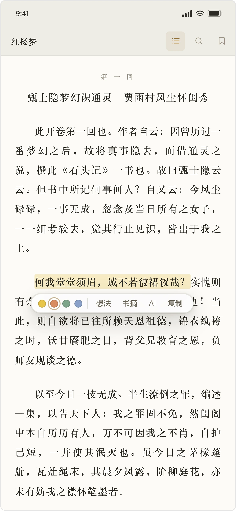
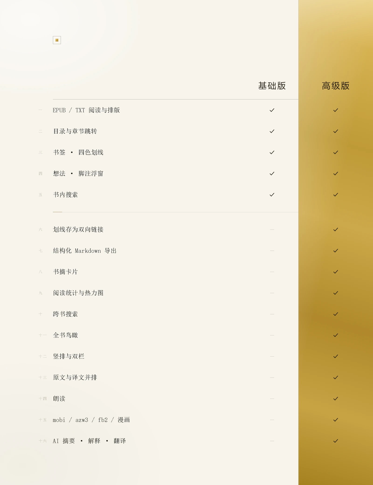

  
  <h1>bz 阅读</h1>
  
<b>把 Obsidian 变成一个能读书的地方。</b> 
  EPUB / TXT 直接读。划线、想法、脚注、统计，全都落回你自己的库。

  

    
    
    
    
  

  <picture>
    <source media="(prefers-color-scheme: dark)" srcset="docs/images/shelf-desktop-dark.webp">
    
  </picture>

## 为什么值得装

- **书在库里。** 书架、进度、划线、想法都在你的 vault 里，跟着同步、备份、迁移，不锁在另一个应用里。
- **划线是能用的文字。** 可以导出成 Markdown、可以反链、可以统计——不是一张截图。
- **像 Obsidian，而不是像另一个软件。** 目录在左侧栏，头栏是原生的，亮暗两套主题自动跟随。
- **手机上也读得完。** 桌面与移动是同一个包，点按翻页、两指沉浸，不用外接键盘。

## 书架：一眼看到读到哪儿

- **继续阅读**一张卡：封面、进度、上次那页都在，点一下直接接上。
- **筛选与排序**：在读 / 未读 / 已读，按最近、书名、进度排；书架分组放自己的分类。
- **封面墙与列表**两种视图，格子随窗口伸缩；手机上自动排三列。
- **搜索、统计、导入、设置**四颗图标收在右上，点开是整页，不是弹窗。

## 阅读：正文吃满一屏

  <picture>
    <source media="(prefers-color-scheme: dark)" srcset="docs/images/read-desktop-dark.webp">
    
  </picture>

- **头栏还给 Obsidian**：目录、搜索、书签、排版、并排对照五颗；手机按真实宽度只留三颗。书签是开关态，这一页签过就实心。
- **一屏只有正文**：单栏 648px，18px / 行高 1.98，段首缩进两字。正文用衬线、界面用无衬线，没有多余的顶栏和底栏。
- **一条胶囊管完划词**：四色在左，想法 / 书摘 / AI / 复制在右，松手即落笔，不等确认。
- **脚注就地展开**：点一下上标，释义浮在那句话下方，不跳章末、不离开当前页。
- **目录常驻左侧**：当前回铜色高亮，翻到哪跟到哪。

## 手机上，一样能读完

  
  &nbsp;&nbsp;
  

- **划词同一条胶囊**：四色、想法、书摘、AI 一字排开，浮在选区下方。
- **点按翻页**：下方下一页，上方上一页——纵向分区，不用去够屏幕左右边。
- **两指轻按**切换沉浸，整屏只剩正文。
- **想法贴底**：输入卡从底部升起，键盘顶起也不遮住正在写的那句。

## 两个版本

  

基础版免费，读完一本书需要的都在里面。高级版把读过的书连成网：双向链接、结构化导出、书摘卡片、阅读统计、跨书搜索、全书鸟瞰，加上更多格式、竖排双栏、双语并排、朗读与 AI。

在 **设置 → 授权** 里填入激活码即可解锁，本地验签，不联网也能用。

## 你的书，留在你的库

- 数据只有一个文件：库里的 `bz 阅读/bz-reader.json`，放在明处，你自己能看到、能备份。
- 不注册、不上传、不统计。断网照样读。
- AI 用你自己的 Key，请求从你的机器直连，不经过我们。

## 常见问题

- **支持哪些格式？** EPUB 与 TXT 开箱即读；mobi、azw3、fb2 与漫画在高级版。
- **会和其他插件打架吗？** 阅读页是 Obsidian 原生视图，目录是左侧栏里的一个页签，双向链接走标准的 `[[ ]]`，不另建索引。
- **换电脑怎么办？** 库同步过去，书架、进度和标注跟着走；高级版在新设备上重新填一次激活码。
- **手机上要单独买吗？** 不用，同一个包，桌面与移动都包含在内。

## 安装

1. 打开 **设置 → 第三方插件**，关闭安全模式。
2. 点 **浏览**，搜索 **bz 阅读**，安装。
3. 启用后左侧出现 bz 图标，从书架开始。

## 许可

本项目以 MIT 许可发布。渲染内核来自 [foliate-js](https://github.com/johnfactotum/foliate-js) 1.0.1（MIT）。
