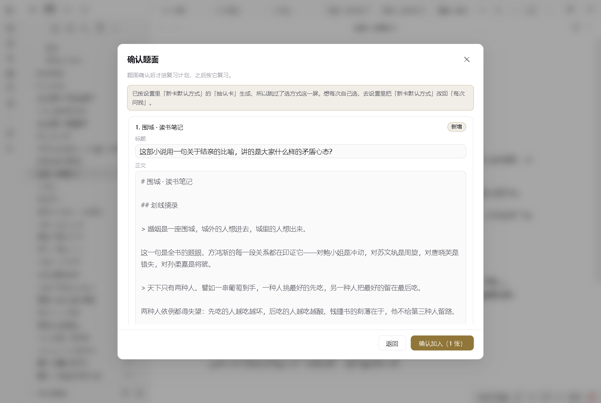
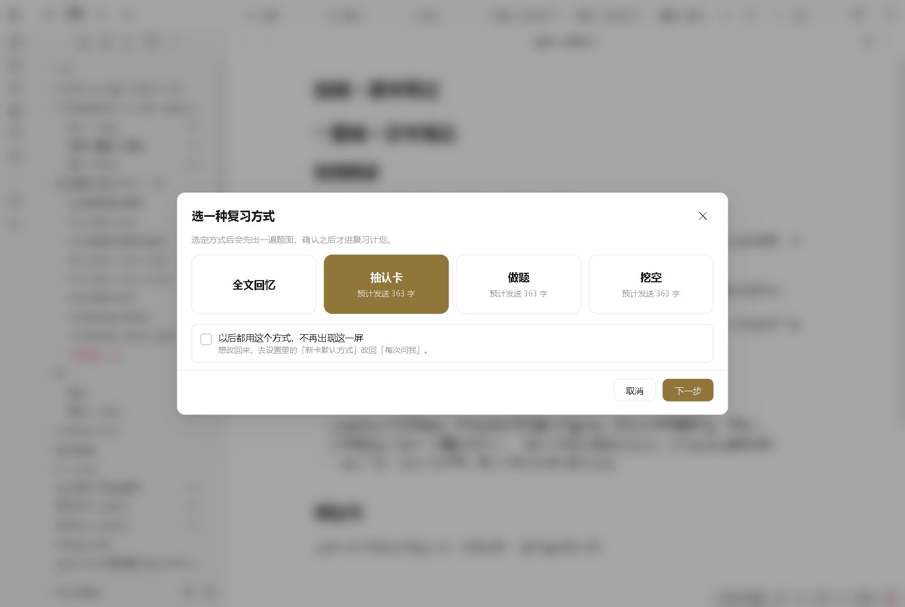
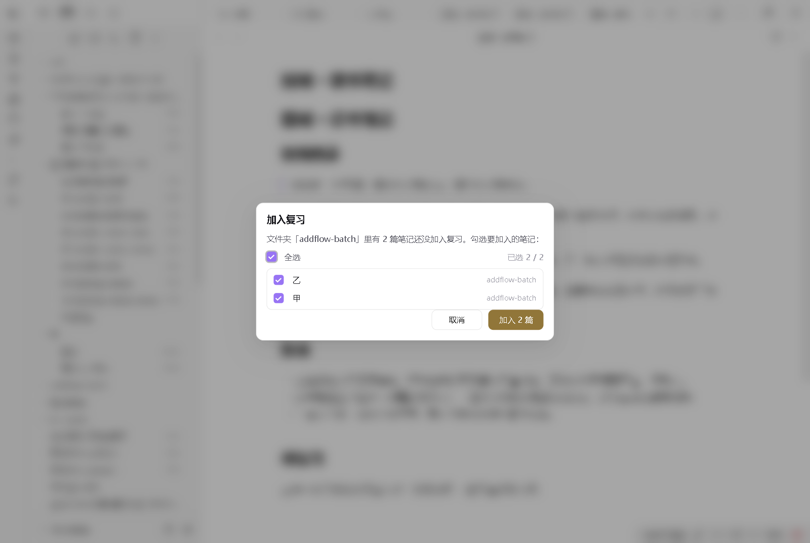
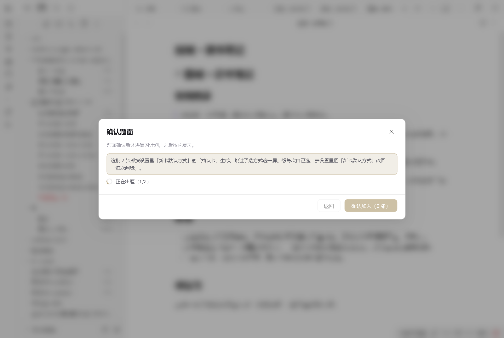
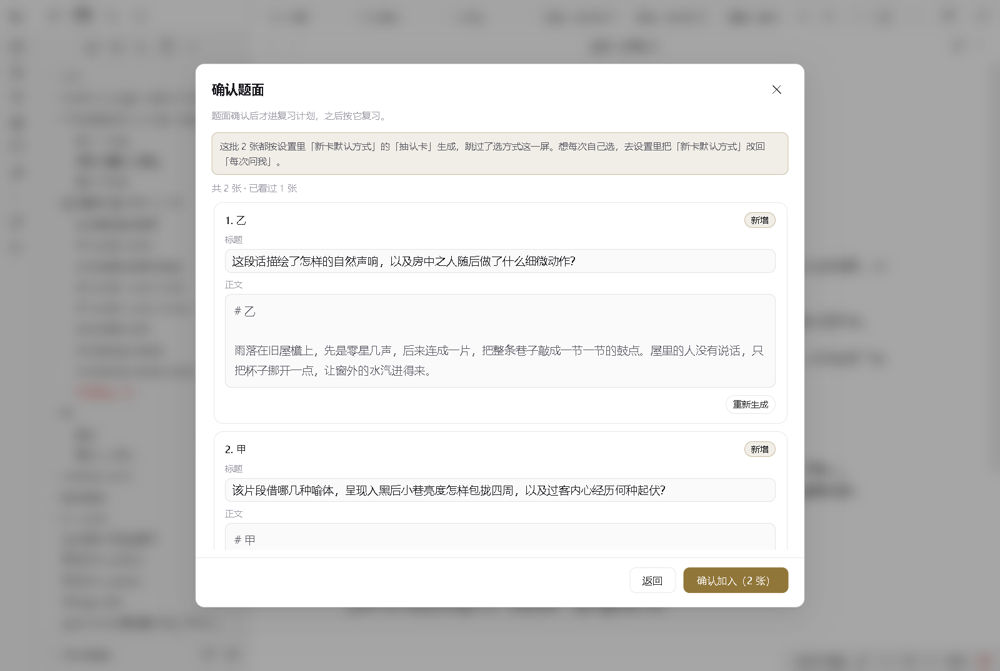
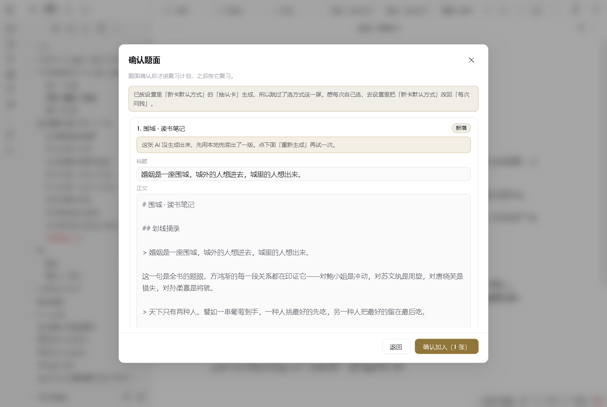
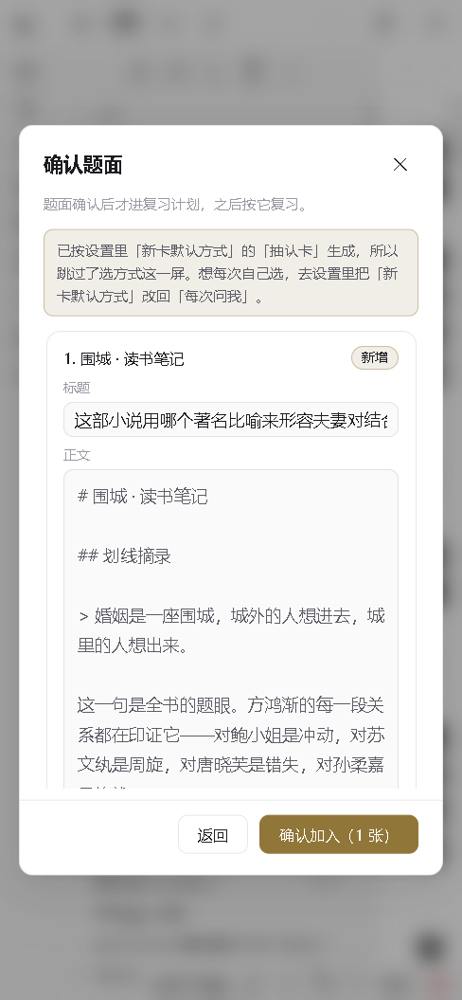

# 预设方式不再绕流程 · 修正与四项增强（2026-11-21）

- **测试库**：`E:\Obsidian\bz review`（只部署测试库，真实库未碰）
- **分支**：`fix/preset-mode-confirm`（worktree `D:\Obsidian\bz-review-wt-preset-confirm`），**尚未合并**
- **设备**：桌面 1280×860；移动端 390×844@3x
- **门禁**：`tsc` 通过；vitest **75 文件 / 706 断言全绿**；`lint-css` **0 error / 0 warning**
- **测试库状态**：已还原（32 条，`addflow-batch` 已删，`reviewCardDefaultMethod` 回到 `manual`，AI provider 回到 `deepseek`，模型覆盖为空）

> 上一版把「不用每次询问」做成了**后台直接写库**——AI 出的题面用户从头到尾看不到，等于让模型替人做了决定。这次改成：预设方式只省掉「选方式」这一屏，题面照样生成、照样停在确认页，取消一个字节不写。

---

## 1. 修正：预设方式停在确认页，不再后台入库

- **问题描述**：`reviewCardDefaultMethod` 不是 `manual` 时，代码走了一条 `silentAdd`，直接 `addCards` 写进计划，AI 内容交给后台队列补；用户既没看过题面，也没法改。
- **一句话说明**：现在「预设方式」只等于「不用问你想用哪种方式」，题面照样出、照样停在你面前；「确认加入」才写库。
- **截图证据**：

  命令入口，抽认卡预设：直接进「确认题面」，没有「选一种复习方式」那一屏，页顶写明原因：

  

- **结论**：通过。
- **回归**：设回「每次问我」，命令入口仍然先问方式（四张方式卡都在，无预设提示）：

  

---

## 2. 增强一：确认页写明「这次是按设置哪个方式生成的」

- **问题描述**：跳过方式屏之后，用户会疑惑「为什么没问我」。
- **一句话说明**：确认页顶部明确写出「已按设置里『新卡默认方式』的『抽认卡』生成」，并给出口——想每次自己选，回设置改回「每次问我」。
- **截图证据**：见上一张（页顶那一条浅色说明）。
- **结论**：通过。

## 3. 增强二：批量确认页有审核进度

- **问题描述**：一次审好几张时，只看到底部「确认加入（N 张）」，不知道自己看到第几张、还有几张没看。
- **一句话说明**：批量时列表上方多一行「共 N 张 · 已看过 M 张」；只有**真的滚到过那张卡**才算看过，全看完变「都看过了」。
- **截图证据**：

  文件夹入口勾选两篇：

  

  生成中（这批的说明也是批量口径）：

  

  出完两张，进度「共 2 张 · 已看过 1 张」（第一张在视口内算看过）：

  

  滚到底再回顶，「都看过了」：

  

- **结论**：通过（关闭后未入库，`review.json` 仍是 32 条）。

## 4. 增强三：AI 没生成出来时，卡上标出来并给重试

- **问题描述**：模型调用失败时，旧代码静默降级（抽认卡拿原文顶正面、做题出 0 题、挖空用规则兜底），用户看不出「这版不是 AI 写的」。
- **一句话说明**：失败的那张卡上会有一条提示「这张 AI 没生成出来，先用本地兜底出了一版」，下面本来就有「重新生成」，可以直接重试；不会再让兜底内容冒充题面混过去。
- **截图证据**：

  

- **结论**：通过（把 provider 临时切到 ollama 制造真实失败，验完已恢复 deepseek）。

## 5. 增强四：批量时说明「这一批都是设置里那个方式生成的」

- **一句话说明**：不是系统替你挑的，是设置里那个方式；批量时文案改成「这批 N 张都按设置里『新卡默认方式』的『抽认卡』生成」。
- **截图证据**：见第 3 节「批量生成中」「批量确认」两张的页顶说明。
- **结论**：通过。

## 6. 顺手修：兜底问句不再带 Markdown 符号

- **问题描述**：AI 失败兜底时，抽认卡正面直接拿整篇笔记第一行，结果变成「# 围城 · 读书笔记 ## 划线摘录 > 婚姻是一座围城…」，标题栏被符号塞满。
- **一句话说明**：兜底问句会跳过标题行、去掉引用 / 列表 / 序号符号，取第一段真正的正文。
- **证据**：修复后同一场景的标题是「婚姻是一座围城，城外的人想进去，城里的人想出来。」（见上一张截图）。
- **结论**：通过。

## 7. 移动端

- **一句话说明**：390×844@3x 下确认页单列排布，说明块与卡片都在，底部按钮并排可点。
- **截图证据**：

  

- **结论**：通过。

---

## 8. 改了哪些文件

| 文件 | 改动 |
|---|---|
| `src/review/add-flow.ts` | 删掉静默入库分支与 `silentAdd`；交付只走制卡窗 |
| `src/review/add-flow-model.ts` | 删掉只服务静默分支的判定函数 |
| `src/review/card-wizard.ts` | 预设分支只跳选方式并记「预设来源」；批量审核进度；AI 失败标记与提示；返回/手选方式时清预设来源 |
| `src/review/card-wizard-model.ts` | 新增审核进度文案、预设说明文案、兜底问句取行 |
| `src/review/styles.css` | 审核进度一行、失败提示的警示配色 |
| 测试 | 删 3 条旧「静默判定」断言，新增 9 条（接线反断言、审核进度、预设文案、兜底取行） |

## 9. 风险与遗留

1. **批量仍然是一次确认**：几十篇会串行生成，页面很长，进度只解决「看到哪儿」，不解决「总量大」。
2. **没配 AI 时会先弹配置引导**：预设方式要 AI；以前静默补不挡人，现在会挡——这是「必须人审」的必然结果。
3. **挖空预设多一步**：生成的是候选空位，还要点词确认。
4. **3 个 jsdom 测试文件起不来**：环境既有问题（共享 pnpm store 缺包），与本轮无关。

## 10. 状态

- 提交：`9c0b94d fix(review): 预设方式只跳过选方式，题面必须人审`
- **未合并**，等你的指令
- 测试库已还原；截图目录 `docs/images/add-flow-preset-confirm-2026-11-21/`（8 张）
