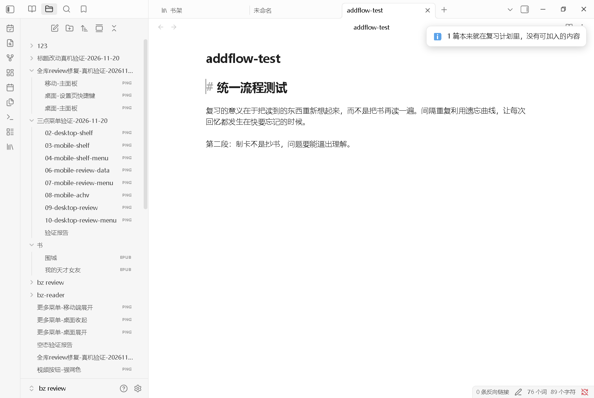
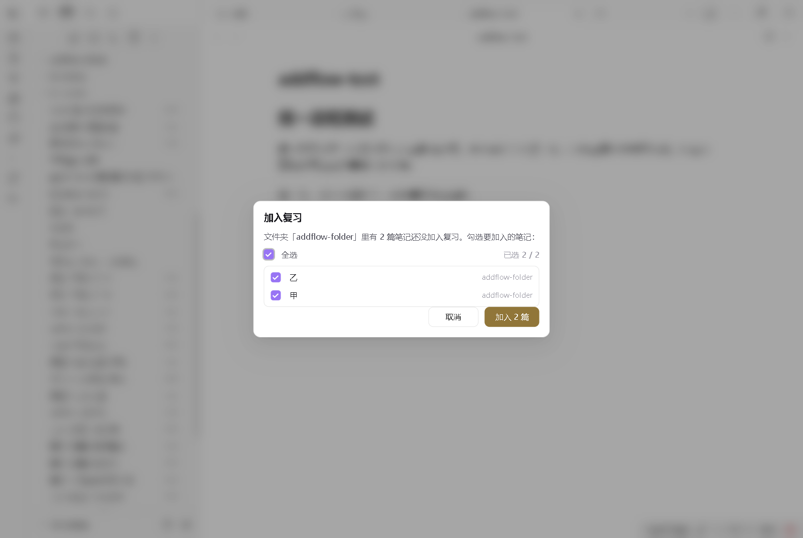
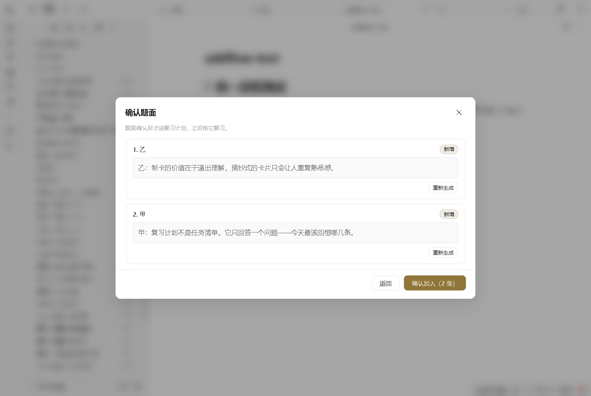
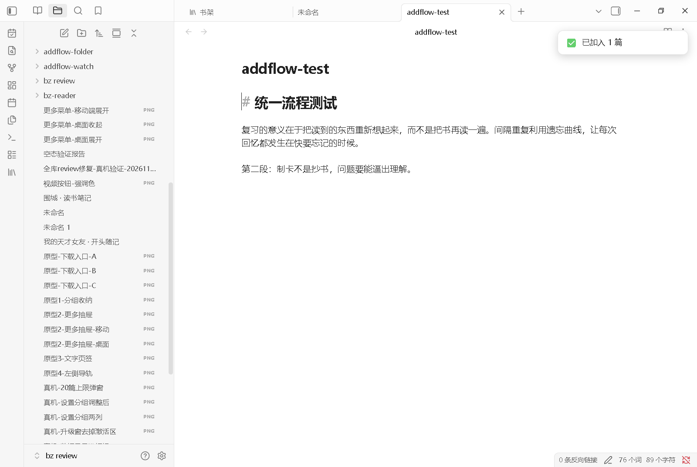
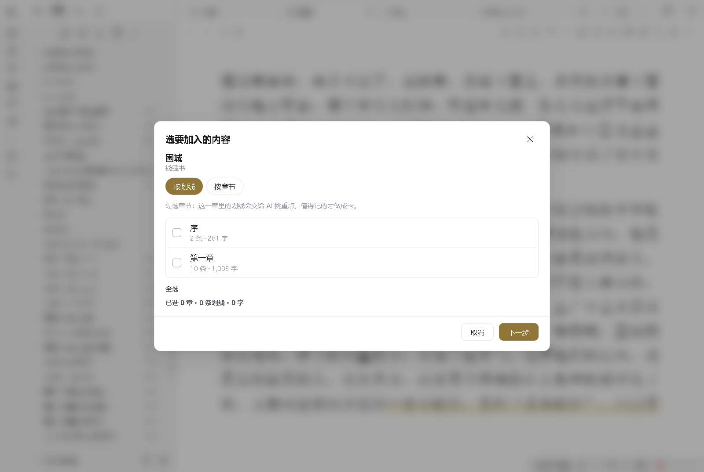

# 「加入复习」统一成一条流程 · 真机验证报告（2026-11-21）

- **测试库**：`E:\Obsidian\bz review`（bz-reader + bz-review 同库）
- **构建**：两仓 master 合并后重新构建，只落测试库；真实库未碰
- **设备**：桌面 1280×860；移动端 390×844@3x（CDP `mobile:true`）
- **门禁**：
  - review：`tsc` 通过；vitest **75 文件 / 700 断言全绿**；`lint-css` **0 error / 0 warning**
  - reader：`tsc` 通过；vitest **359 文件 / 4037 通过 + 17 跳过**
  - review 另有 3 个 jsdom 测试文件（settings-split / settings-page / review-dialogs）因共享 pnpm store 缺包起不来——主仓同样红，属环境既有问题，与本轮改动无关

> 用户原话是「它们的流程都不一样，各自调用各自的面板，非常的奇怪」。改完之后只有**一个**分流点：`review/add-flow.ts` 的 `openAddToReviewFlow`；下面每一条入口都是真机点的，不是看代码推的。

---

## 0. 改动边界

- **bz-review**：新增 `add-flow.ts`（唯一入口与分流）、`add-flow-model.ts`（纯逻辑：整篇钥匙 / 正文构造 / 截断 / 文件夹候选 / 静默判定 / 结果话术）、`card-text.ts`（给模型看的正文口径）。`index.ts` 四个命令入口、`main.ts` 文件树右键与门面、`ui.ts` 空态、`watch.ts` 监听全部改走 `openAddToReviewFlow`。
- **bz-reader**：删掉已经没人读的 `reviewAskMode` / `reviewLastMode` 设置项（含 8 个语言包 key）与 `reviewadd` 死分支、`openReviewAdd` 死入口。
- **不动的**：`D:\Obsidian\bz` 主插件那套「加入复习计划」是另一个插件、另一份数据（`CONFIG/STORAGE/review.json`），按你的要求完全没碰。

---

## 1. 命令入口：把当前笔记加入复习

- **问题描述**：以前命令直接 `addItem` 写库，没有面板、没有 AI、没有方式选择；和阅读器那条路完全不同。
- **一句话说明**：命令触发后不再直接入库，先弹「选一种复习方式」四选一，再进「确认题面」，确认后才写计划。
- **截图证据**：

  四选一（全文回忆 / 抽认卡 / 做题 / 挖空，预计发送 363 字）：

  

  确认题面（整篇正文进卡，frontmatter 已去掉；底部「确认加入（1 张）」）：

  

- **结论**：通过。

## 2. 重复加入：不再重复弹窗

- **问题描述**：第一次改完真机就踩到了——笔记统一成整篇卡之后，排期表里存的是 `note:<path>`，而入口查重只问真实路径，第二次点命令还会再弹一次选方式。
- **一句话说明**：现在两种钥匙都问（旧版整篇条目 + 新流程的整篇卡），重复点只给一句话，不再开制卡窗。
- **截图证据**：

  同一篇再点命令，只提示「1 篇本来就在复习计划里，没有可加入的内容」：

  

  CDP 直接查排期表，两种钥匙都是 `planned:true`：

  ```
  note:addflow-folder/甲.md  planned=true
  note:addflow-folder/乙.md  planned=true
  note:addflow-test.md      planned=true
  ```

- **结论**：通过（这条是修复后复验）。

## 3. 文件树右键 · 单篇

- **问题描述**：用户点名的入口。以前右键文件夹/笔记直接批量写库，只有一条通知。
- **一句话说明**：右键菜单「加入复习」→ 走同一条四选一流程；菜单项由 CDP 断言确认，合成右键不会驻留菜单，所以截图是点完之后的制卡窗。
- **截图证据**：

  右键 `围城 · 读书笔记.md` 点「加入复习」后：

  

- **结论**：通过。

## 4. 文件树右键 · 文件夹

- **问题描述**：以前文件夹是一次性递归写库，用户连哪几篇进去了都不知道。
- **一句话说明**：现在先弹「勾选要加入的笔记」，勾完再进同一条流程；面板里能全选、能看已选数量。
- **截图证据**：

  勾选面板（2 篇，已选 2 / 2，按钮「加入 2 篇」）：

  

  勾完直接进四选一：

  

  两张一起确认（「确认加入（2 张）」）：

  

- **结论**：通过。

## 5. 面板空态

- **问题描述**：空态以前只有「看视频教程 / 从 Anki 导入 / 从阅读器加入复习」，笔记类入口是断的。
- **一句话说明**：空态补上第四颗按钮「把当前笔记加入复习」，点它同样走四选一。
- **截图证据**：

  「复习还是空的」+ 四颗按钮（看视频教程 / 从 Anki 导入 / 从阅读器加入复习 / 把当前笔记加入复习）：

  

  点「把当前笔记加入复习」：

  

- **结论**：通过。
- **说明**：这一屏需要清空计划才能看到，验证时备份了 `bz review/review.json`、截完恢复并核对了条数（36 → 32，剔掉的是本轮测试条目）。

## 6. 监听新建笔记

- **问题描述**：以前新笔记被监听器直接写库，只发一条「已自动加入复习」。
- **一句话说明**：现在新建笔记 3 秒后会弹同一条流程；如果设置里已经选了「不用每次询问」，就直接入库不再弹。
- **截图证据**：

  新建 `addflow-watch/监听甲.md` 后自动弹出四选一（预计 27 字）：

  

  把「新卡默认方式」设成「全文回忆」后再新建 `监听乙.md`：不弹窗，只给一条「已加入 1 篇」，排期表里 `note:addflow-watch/监听乙.md` 已 `planned:true`：

  

- **结论**：通过（两种分支都验了）。
- **说明**：制卡窗里那句「以后都用这个方式，不再出现这一屏」勾上后写的就是设置里的「新卡默认方式」（`reviewCardDefaultMethod`），没有另加开关。

## 7. 阅读器书右键

- **问题描述**：书内入口本来就是「选内容 → 制卡」，这轮要确认它没被改出第二条路。
- **一句话说明**：书卡右键「加入复习」→ Review 的「选要加入的内容」→ 按划线 / 按章节 → 下一步。
- **截图证据**：

  

- **结论**：通过。

## 8. 移动端

- **一句话说明**：390×844@3x 下同一条流程的选方式屏，2×2 网格不挤、按钮不折行。
- **截图证据**：

  

- **结论**：通过。

---

## 9. 顺手清掉的死配置与死代码（你没点到的）

| 位置 | 问题 | 处理 |
|---|---|---|
| review 设置「新笔记加入提醒」`reviewAutoAddNotice` | 自动加入改走流程后，这个开关不再有任何读取方 | 删除设置项与字段 |
| review `app.addCurrentToReview` | 第二套「直接写库」的方法，留着就是后门 | 删除 |
| reader 设置「加入复习先选方式 / 上次用的方式」 | 流程搬走后无人读取，开关还在设置页 | 删除（含 8 个语言包 key 与测试） |
| reader `actions.ts` 的 `reviewadd` 分支 | 侧栏入口撤掉后没有派发点 | 删除 |
| reader `openReviewAdd` | 同上，死入口 | 删除 |
| 五个入口的提示口径 | 有的说「已在复习中」，有的静默，有的报异常 | 统一走 `addSummaryText`（已加入 / 本来就在 / 找不到 / 超额） |
| 整篇笔记的正文 | frontmatter 会进卡、整篇几千字全塞提示词 | frontmatter 不进卡；模型只看前 1500 字（`card.aiText`） |
| AI 出题失败兜底 | 整篇笔记会把全文当问句面 | 兜底问句改截断（60 字） |

## 10. 风险与遗留

1. **笔记条目从「引用路径」变成「正文快照」**：老条目不动，新加入的是卡片（`note:<path>`）。想升级老条目要先移出再重加，本轮没做自动迁移。
2. **批量逐篇出题慢**：文件夹/监听批量是「同一个方式 + 一次确认」，几十篇会串行生成，只能等。
3. **静默入库没有界面**：设了「不用每次询问」后直接写卡，AI 内容由后台队列补；想改题面得回列表里「重新生成」。
4. **bz 主插件未统一**：它和 bz-review 是两份数据，按你的要求没动。
5. **3 个 jsdom 测试文件起不来**：环境既有问题（共享 pnpm store 缺包），主仓同样红，与本轮无关。

## 11. 复现路径

- 命令：命令面板 → `Review: 把当前笔记加入复习`
- 文件树：右键笔记 / 文件夹 → 「加入复习」（文件夹是「加入复习（文件夹）」）
- 空态：复习面板为空时的第四颗按钮
- 监听：设置里勾一个监听文件夹 → 往里新建 md
- 免询问：设置 → 复习 → 「新卡默认方式」改成非「每次问我」
- 阅读器：书架 → 书卡右键 → 「加入复习」

## 12. 提交

| 仓 | 提交 | 内容 |
|---|---|---|
| bz-review | `4cf68d4` | 所有入口统一成一条流程（21 文件，+892 / −210） |
| bz-review | `a46c63e` | 合并回 master |
| bz-review | `fef7517` | 重复查重认两种钥匙（真机发现） |
| bz-reader | `7445c1e` | 删死开关与死入口 |
| bz-reader | `575765a` | 合并回 master |
| bz-reader | 本轮报告 | 本文件 + HTML + 15 张截图 |

> 测试库只部署了构建产物；`addflow-test.md`、`addflow-folder/`、`addflow-watch/` 与对应的排期条目已清理干净（`review.json` / `review-quiz.json` / `review-meta.json` / `review-trash.json` 均无 `addflow` 残留）。
