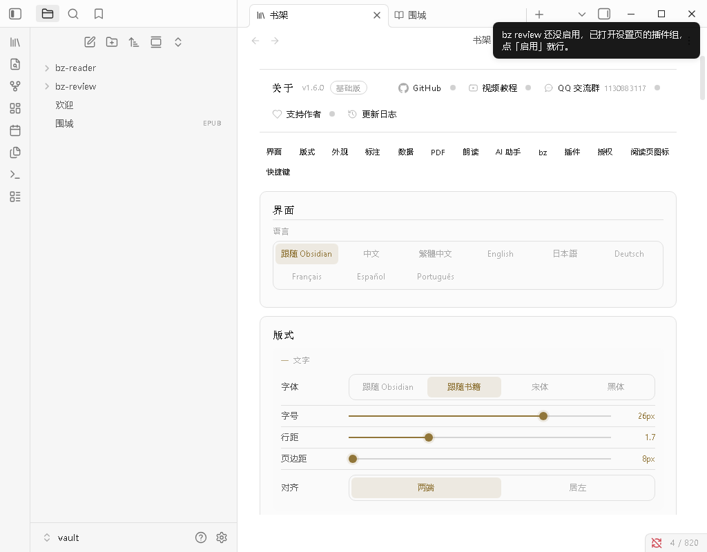

# 插件组三态 +「加入复习」入口常显（2026-11-21）

- 分支：`feat/plugin-review`（worktree `D:\Obsidian\bz-reader-wt-plugin-review`）
- 验证环境：独立 Obsidian 实例（新库 `bzr-plugin-install2`，桌面 1024×800 / 手机 390×844@3x）
- 测试书：`围城.epub`

## 一、改了什么

1. **「插件」组三态**：未安装 / 已安装 · 未启用 / 已启用。判据是「宿主有没有把 bz-review 真正加载起来」，不是猜目录。
2. **未安装时「安装」**：后台下载三件套 → 写进 `<配置目录>/plugins/bz-review/` → 让宿主启用。GitHub 连不上自动切码云；两条都不通才打开下载页兜底。
3. **已安装未启用时「启用」**：不再重复下载，直接让宿主加载并写进启用名单；成功后卡片原地刷新。
4. **已启用时**：只留「看教程」，不再摆按钮。
5. **划线工具条「复习」常显**：没装 / 没启用也保留在工具条上。
6. **书卡右键「加入复习」常显**：同上，位置仍是「书籍详情」之后。
7. **点了怎么办**：没装 / 没启用时弹一句提示，并打开书架设置页、滚到「插件」组、把那组闪一下；已装且启用时行为不变（已加入的显示「去复习」）。
8. **文案**：描述换成你给的 FSRS 版本；未安装与未启用各有一句说明；安装失败按「连不上 / 写不进 / 启用不了」分开说。

## 二、真机验证

### 1. 未安装

打开「书架 · 设置 · 插件」，卡片显示「未安装」、按钮「安装」，下面一行说「点安装会在后台下载并启用」。

### 2. 点「安装」→ 已启用

点完约 10～15 秒（GitHub 直链在国内偏慢，期间有常驻通知「正在下载 bz review…」）。完成后卡片自动刷新为「已启用」，铜色边框，不再有按钮；左侧栏出现 bz-review 的图标。

### 3. 已安装未启用

在实例里把 bz-review 禁用（保留目录），重进设置页：徽章「已安装 · 未启用」，按钮变「启用」，下面一行「已经装好了，只是还没启用。点启用就能用」。

### 4. 点「启用」→ 已启用

点完立即恢复，无需重载 Obsidian。

### 5. 书卡右键「加入复习」常显

bz-review 处于**禁用**状态，书架书卡的右键菜单里仍有「加入复习」（第 3 项，图层图标）。

### 6. 点「加入复习」→ 设置页插件组

菜单点掉后自动切到「书架 · 设置」，滚动到「插件」组并闪一下；右上角提示「bz review 还没启用，已打开设置页的插件组，点启用就行」。

### 7. 划线工具条「复习」常显

bz-review 仍禁用。在正文里拖选一段文字，工具条依次是「想法 / 书摘 / 复习 / AI / 双链 / 复制」——「复习」在。

### 8. 点工具条「复习」→ 设置页插件组

工具条收起、跳到设置页插件组，提示与书右键那条一致。

### 9. 手机端

390×844 下「插件」组卡片：徽章、三行描述、标签、启用按钮、虚线提示都在框内，没有横向溢出，底部导航不挡内容。

## 三、门禁

- `node node_modules/typescript/bin/tsc --noEmit`：通过
- `node node_modules/vitest/vitest.mjs run`：363 个文件 / 4083 项通过（17 项跳过）
- `node esbuild.config.mjs once`：通过

新增/更新测试：

- `tests/review-install.test.ts`：GitHub 直链、码云 assets 挑选、清单校验
- `tests/review-bridge.test.ts`：三态判定（启用 / 禁用 / 未安装）
- `tests/review-require.test.ts`：没装 / 没启用时跳设置页并排队定位
- `tests/book-menu.test.ts`：加入复习常显与新顺序
- `tests/text-toolbar.test.ts`：没装时复习仍在
- `tests/settings-render.test.ts`：三态卡片与按钮
- `tests/review-add-thin.test.ts`：入口提示口径

## 四、已知边界

1. **手机端划词工具条的截图**：CDP 的触摸事件触发不了系统级文本选择，所以手机端只截了设置页。手机工具条的「前三颗 = 想法 / 书摘 / 复习」由 `tests/text-toolbar.test.ts` 的 compact 排布用例保证；桌面真机已验证同一颗按钮的显示与跳转。
2. **下载耗时**：GitHub 直链在国内约 10～15 秒，期间用常驻通知挂着；失败会按原因提示并打开下载页。
3. **外语**：本次新增 14 个中文 key，其余七包已由脚本补 `[TODO]` 占位；正式翻译按流程留到上架前一次补齐。
