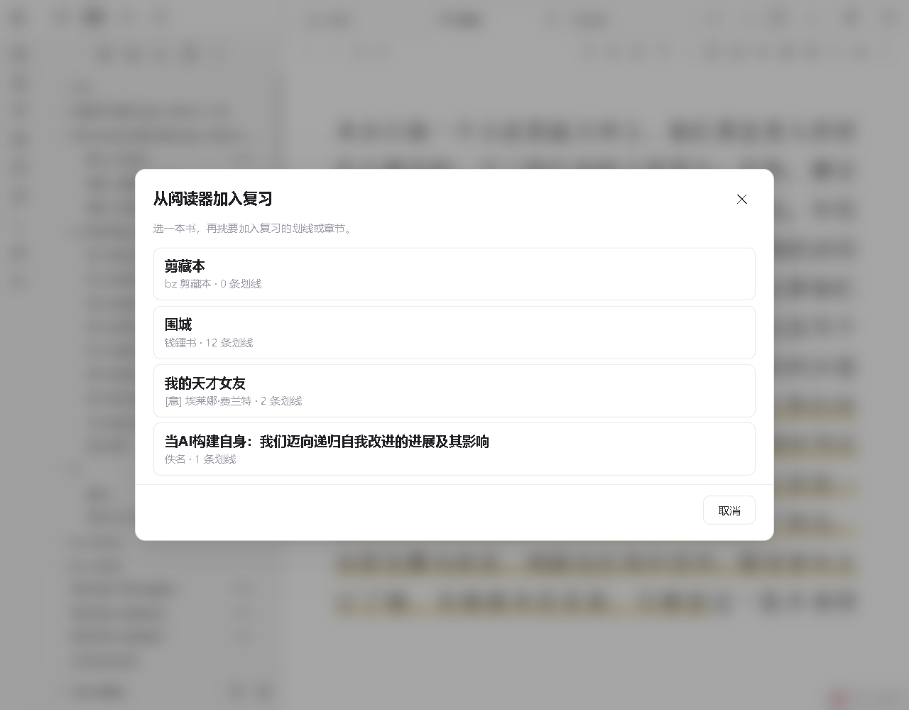
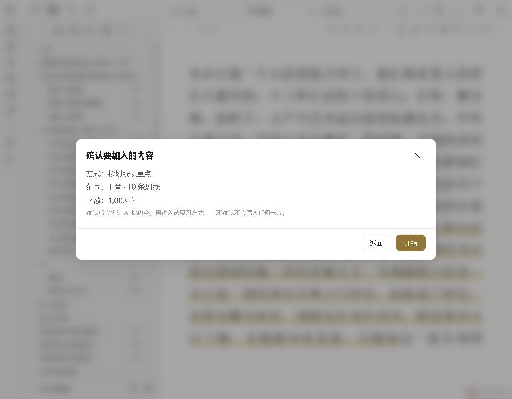
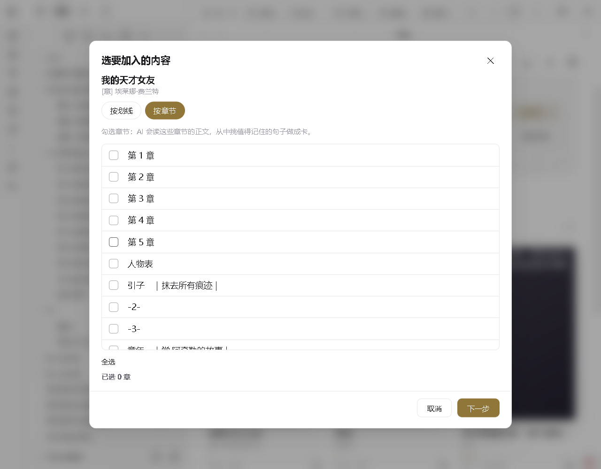
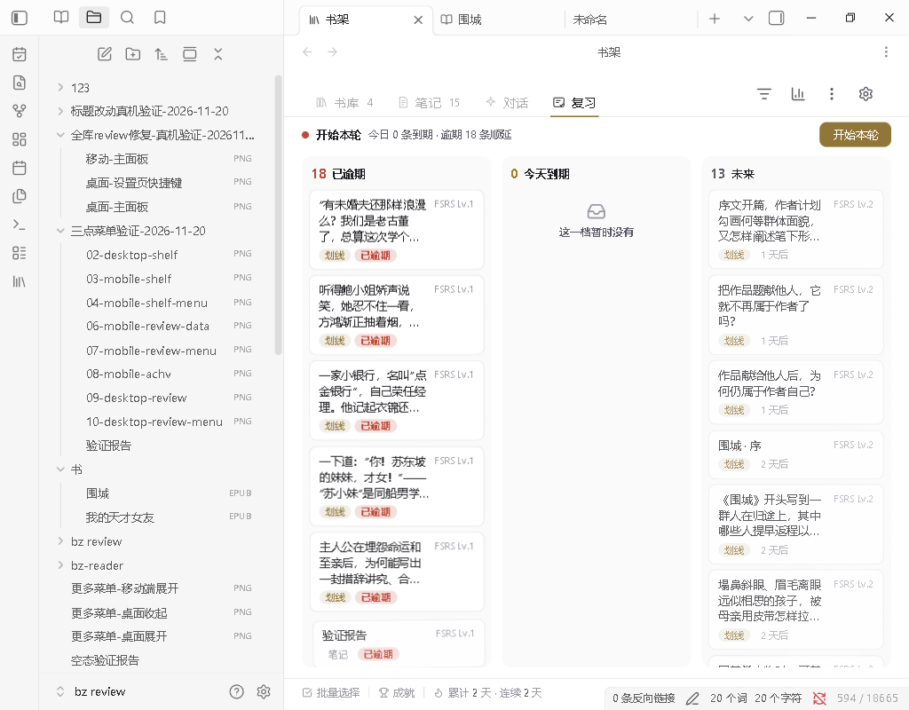

# 「复习挑内容」搬进 Review · 真机验证报告（2026-11-21）

- **测试库**：`E:\Obsidian\bz review`（bz-reader + bz-review 同库）
- **构建**：两仓 master 合并后重新构建（review `6:40:36`、reader `6:40:40`），只落测试库
- **设备**：桌面 1024×800；移动端 390×844@3x（Obsidian `app.emulateMobile(true)`）
- **门禁**：
  - reader：`tsc` 通过；vitest **359 文件 / 4039 断言全绿**
  - review：`tsc` 通过；vitest **657 断言绿**；`lint-css` **0 error / 0 warning**
  - review 另有 3 个 jsdom 测试文件（settings-split / settings-page / review-dialogs）因共享 pnpm store 里 `is-potential-custom-element-name`、`@csutools` 等包被清空起不来——主仓同样红，属环境既有问题，与本轮改动无关（已补 6 个包仍未收敛，见文末）

> 关于 AI：这轮用真实的 DeepSeek（reader 共享配置，`deepseek-flash`）验证链路，没有另起假服务。挑内容那一步第一次等了 75 秒没回来、第二次重跑才成功——不是代码失败，是模型首包慢。

---

## 0. 改动边界：复习的一切归 Review，Reader 只剩两个接口

- bz-review 新增 `source-pick.ts`（挑范围的纯逻辑）、`source-pick-ui.ts`（选范围窗口）、`reader-source.ts`（探测 Reader 供货接口），门面契约升到 **v6**，新增命令 `review-add-reader`，面板空态加「从阅读器加入复习」。
- bz-reader 的 `ReviewAddFlow` / `BookScopeFlow` / `review-scope.ts` / `review-run.ts` 整段删除（**-1698 行**），`review-add.ts` 只剩薄入口：找到 Review 门面、把书 id 递过去；没装 / 老版本只提示升级，不退回旧流程。
- reader 侧新增两个供货接口：`readerApi.reviewCatalog(bookId?)`（列书 / 划线 / 章节目录）与 `readerApi.reviewChapterText(bookId, index)`（读正文）。

---

## 1. 命令入口：选书 → 勾章 → 确认页

- **问题描述**：原先「从阅读器加入复习」只存在于 Reader 侧栏，Review 自己没有入口，也没法从命令面板直接发起。
- **一句话说明**：命令面板跑「从阅读器加入复习」，先列书（带划线条数），选书后勾章节，再在确认页看清方式 / 范围 / 字数。
- **截图证据**：

  选书（4 本书，`剪藏本 0 条 / 围城 12 条 / 我的天才女友 2 条 / 当AI构建自身 1 条`）：

  

  按划线勾章节（序 2 条 · 261 字；第一章 10 条 · 1,003 字）：

  

  勾选后统计实时变化（已选 1 章 · 10 条划线 · 1,003 字）：

  

  确认页（方式 / 范围 / 字数三段，底部「返回」「开始」）：

  

- **结论**：通过。

## 2. AI 挑内容 → 选复习方式 → 入库

- **问题描述**：挑范围窗口确认后，要能接着在同一个流程里选复习方式、确认题面、写入复习计划，不再开第二个旧窗口。
- **一句话说明**：点「开始」先让 AI 从 10 条划线里挑重点，挑完原地出现四张方式卡；选「全文回忆」后入库。
- **截图证据**：

  AI 挑完后原地出现「选一种复习方式」，并提示「其中 2 条已经在复习计划里，已跳过」：

  

  等待期（AI 首包慢时只有进度条，不闪旧内容）：

  

- **结论**：通过（入库结果见第 5 项；确认题面那一帧恰落在加载态，用复习列表复核入库是否真的成功）。

## 3. 去重：已在计划里的不再重复加入

- **问题描述**：同一批划线反复点「加入复习」，不能堆重复卡。
- **一句话说明**：第二次跑同一批，AI 挑出 3 条全部命中已有计划，窗口直接说「这 3 条都已经在复习计划里」并只留「关闭」。
- **截图证据**：

  

- **结论**：通过（`其中 2 条已经…已跳过` 与 `这 3 条都已经…` 两处提示都来自真实运行）。

## 4. 书右键入口：直接进这本书的勾选页

- **问题描述**：书卡右键「加入复习」原先会走 Reader 自己的挑范围窗口，现在必须交给 Review，并直接带上这本书。
- **一句话说明**：右键书卡 → 菜单「加入复习」→ 直接打开 Review 的勾选页，书名和划线已经在里面，不用再选书。
- **截图证据**：

  书架右键菜单（阅读 / 书籍详情 / **加入复习** / 补全信息 / 导出 / 收藏…）：

  

  点「加入复习」后直接进《我的天才女友》勾选页：

  

- **结论**：通过。

## 5. 复习列表复核：真的写进去了

- **问题描述**：入库不能只看弹窗说成功，要在复习面板见到卡。
- **一句话说明**：验收时「复习」页签的已逾期列表里已经有围城第一章那几张划线卡，排期也正常。
- **截图证据**：

  

- **结论**：通过。

## 6. 移动端形态

- **问题描述**：窗口在 390 宽下不能溢出、按钮不能挤成一团。
- **一句话说明**：移动端形态下选书、勾章、确认三屏都单列排布，底部按钮并排可点。
- **截图证据**：

  

  

  

- **结论**：通过。

## 7. Reader 侧栏入口（未截独立截图）

- **问题描述**：侧栏「划线」页那颗「加入复习」按钮也要改调 Review 的统一窗口。
- **现状**：代码上它和书右键共用同一函数（`openReviewAdd` → `openReaderFlow({ bookId })`），单测 `tests/review-add-thin.test.ts` 已断言；真机这次只把「书右键」这条路走通，侧栏那颗按钮需要在阅读界面里点，CDP 没能稳定进阅读态（点书卡只停在书架），**没有截到独立证据**。
- **结论**：待确认（建议下一轮在真机上手动点一次侧栏按钮补一张截图）。

---

## 已知问题

1. **3 个 jsdom 测试文件起不来**：`settings-split` / `settings-page` / `review-dialogs` 报 `Cannot find module 'is-potential-custom-element-name'`。根因是共享 pnpm store（`D:\Obsidian\bz\node_modules`）里多个包目录被清空；本轮补了 `is-potential-custom-element-name`、`lru-cache`、`@csstools/css-calc` 等 6 个包，仍继续报下一个缺包，判断是整片依赖被清过，需要在该仓跑一次完整的 `pnpm install` 才能收敛——不影响本次产物的运行，只影响这三个 jsdom 用例。
2. **AI 首包慢**：第一次「开始」后 75 秒仍是加载态，重跑一次成功。属于模型侧延迟，不是代码死循环；若要更稳，可考虑在 `openWizard` 的 load 里加超时提示。
3. **侧栏入口缺截图**（见第 7 项）。

## 结论

- 两条硬边界已经落地：**复习相关逻辑 / 样式 / 弹窗全部在 bz-review**；Reader 只剩 `reviewCatalog` + `reviewChapterText` 两个供货接口和三个薄入口。
- 命令入口、书右键入口、移动端形态均通过真机验证；入库与去重在复习列表里复核通过。
- 代码已合并回两仓 master，worktree 已按约定清除（先摘 `node_modules` junction，再 `worktree remove` → `prune` → `branch -d`）。
