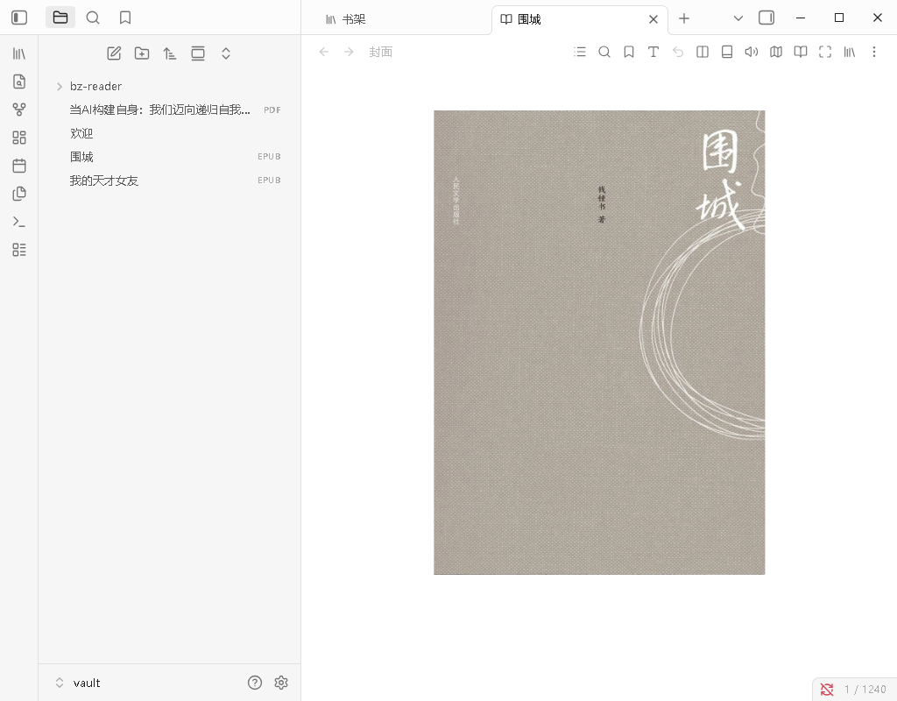
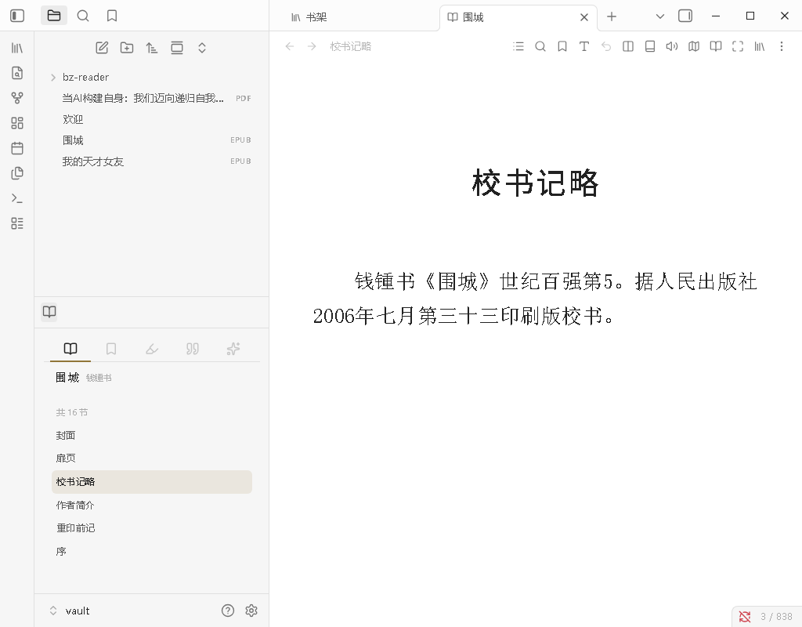
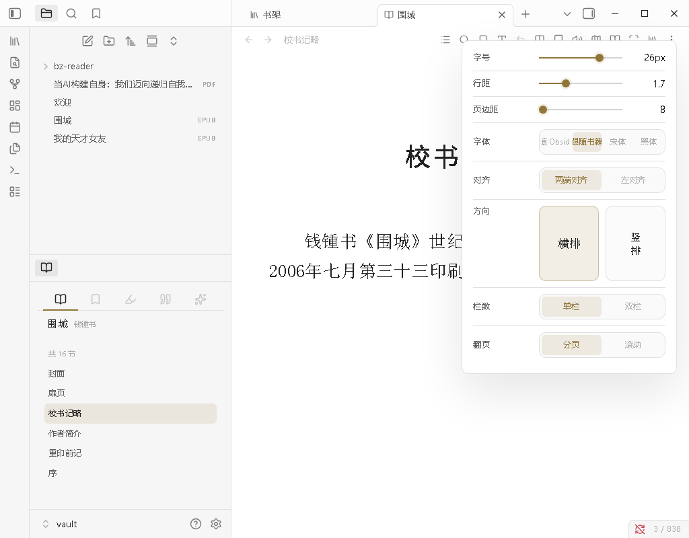
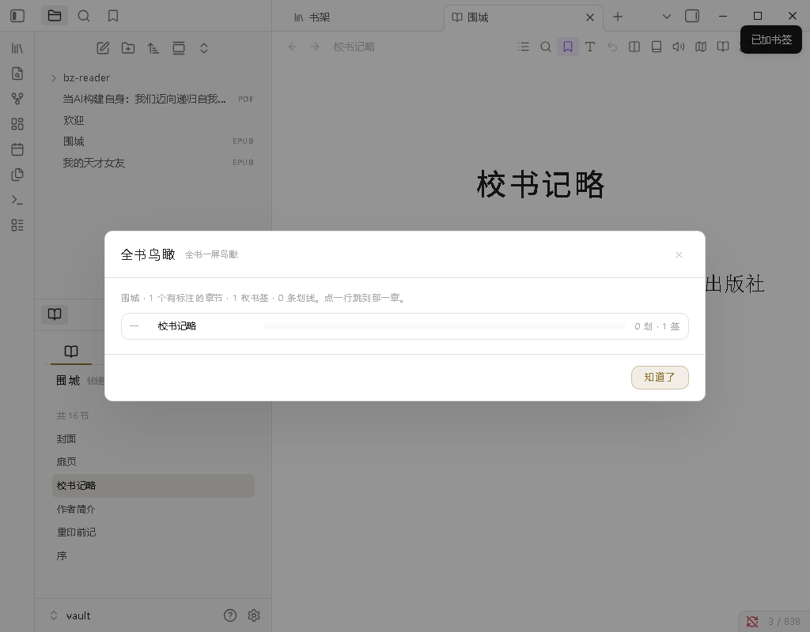
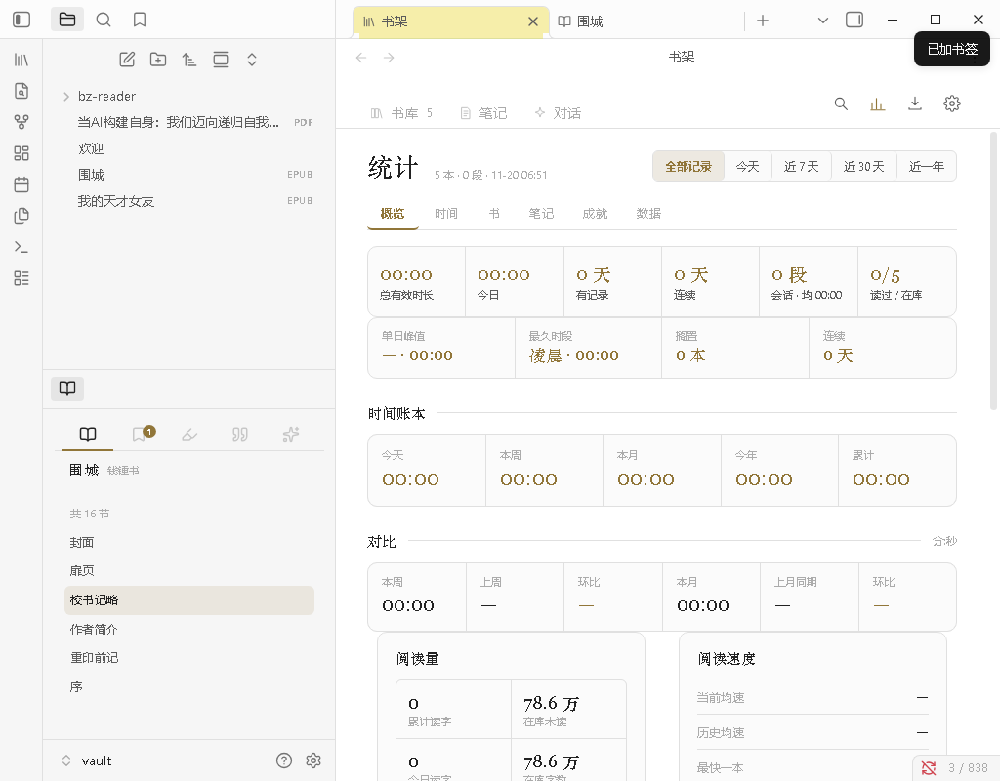
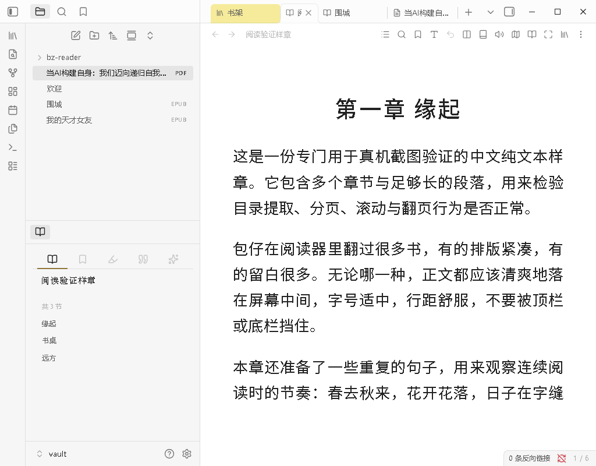

# 整库 Review + 全库真机验证报告（2026-11-20）

> 范围：`bz-reader` 全库（约 314 个源码 TS、361 个测试文件）。
> 流程：整库 review → 修复全部确认问题 → 三道门 → 合并 master → 部署测试库 → 全库真机截图验证。
> 基线门禁：tsc ✓ / vitest 361 文件 4104 用例 ✓ / tooltip 检查 ✓。
> 合并提交：`dd6f145 fix(review): 修整库 review 发现的五处缺陷`（ff-only 合入 master，worktree 已清理）。

---

## 一、整库 Review 结论

用 5 个并行审查 agent 按模块（core / data / engine / shell / view-ui-i18n-配置）逐个文件通读，按 code-review skill 的两轴口径审查：

- **Standards（编码规范）**：仓库硬性规则 + Fowler 坏味道基线。
- **Spec/Bug（需求符合度与真实缺陷）**：逻辑错误、状态机缺陷、资源泄漏、边界处理、付费门禁。

整体质量高，绝大多数模块符合全部硬性规则：无 `dist/base` 双包、无悬停气泡属性、翻译只写 `zh.ts`、日志写数据目录、坐标换算按已知坑处理、生命周期与监听清理完整、异步竞态有判号、`requireCap` 门禁成对。**共确认 5 个问题**（4 中 + 1 轻，另有 1 处门禁脚本漏洞），全部已修复。

> i18n 七种外语的 209 条 `[TODO]` 是发版流程统一补齐的预期开发态，非本次缺陷。

---

## 二、修复清单（5 项，均已合并）

| # | 严重度 | 位置 | 问题 | 修复 |
|---|--------|------|------|------|
| 1 | 中 | `src/data/ai.ts` `postChat` | abort 监听与超时计时在 fetch 返回时就清理，但流式读取在其之后执行——流式阶段「取消请求」传不到 controller，回答继续输出/计费，只能等自然结束 | 用 `try/finally` 包住整次问答（含读流），清理延后到函数结束；读流结束清残留 timer |
| 2 | 中 | `src/core/offline-player.ts`、`src/core/tts-player.ts` | `start()/jump()` 先置 `loading` 再异步读盘，此时 `pause()` 因 `state!=='playing'` 直接返回、`wantPlay` 未清零，读盘回来照常播放——加载期暂停失效 | `pause()` 在 `loading` 态也生效并置 `wantPlay=false`、`token++`；`resume()` 处理 audio 未建好时重新起播 |
| 3 | 轻 | `src/core/offline-player.ts` `start()/jump()` | `ensure()` 异步却无代次校验，快速连点「下一句」时旧请求回来覆盖新句导致错位 | 加单调递增 `token`，`.then` 内比对一致才 `playFrom`；`stop/fail/finish` 同步作废代次 |
| 4 | 中 | `src/engine/pdf/view.ts` | 渲染失败页 `failed.add()` 后 `enqueue` 永久跳过；缩放/旋转只 release `rendered` 页、从不清 `failed`——旋转后空壳页永久空白、缩放后旧错误提示不消失 | 抽纯函数 `resetFailedPages()`，`applyScale`（旋转也经它）清空失败标记并清 DOM 提示，失败页重新入队 |
| 5 | 轻 | `src/engine/pdf/view.ts:1070` + `scripts/check-tooltip-attrs.mjs` | `mark.title = ...` 给 DOM 挂 `title`，违反禁悬停气泡规则；且门禁正则只认 `title="..."`/`setAttribute`，恰好漏掉 `.title = value` 赋值 | 删除违规行；门禁脚本补 `DOM .title =` 规则（限常见元素变量名，不误伤 `book.meta.title` 数据字段） |

**TDD 落地**：每处先写复现测试跑红，再改实现跑绿，测试与实现同一提交。新增/修改测试：`ai-stream` / `offline-player` / `tts-player` / `pdf-retry-failed`（新建）/ `no-tooltip-attrs`。

**提交后门禁**：tsc ✓ / vitest **362 文件 4096 通过（17 skipped 为需密钥的 entitlement 用例）** / esbuild ✓；tooltip 检查 ✓。已部署测试库 `E:/Obsidian/bz review/.obsidian/plugins/bz-reader`（main.js 20755535 bytes，06:38 构建）。

---

## 三、真机验证环境与方法

- 工具：`obsidian-visual-test`（真 Obsidian 进程 + 独立库 + 随机调试端口 + CDP 截图），非 mock、非 DOM 快照。
- 两个实例：
  - **高级版实例**（`bz-report-pro`）：注入测试激活码 + EPUB《围城》《我的天才女友》+ PDF《当AI构建自身…》+ 自制 TXT 样章。
  - **基础版实例**（`bz-report-base`）：无激活码，验证付费门禁。
- 桌面视口 1024×800；移动端 390×844@3x（截图 1170×2532，含刘海/底栏安全区）。
- 全程无未预期控制台错误；验证后已 `stop` 释放进程，截图持久保存于 `D:\obs-test-runs\report-shots\`。

---

## 四、逐项验证与截图

### 桌面端（高级版）

**1. 书架初始态** — 空库只有「剪藏本」虚拟书，顶部「书库/笔记/对话」三 tab、搜索/统计/导入/设置入口齐全。

**2. 导入并收录 4 本书** — 导入页识别出库内 EPUB/PDF/TXT 共 4 本，一键加入后书架显示 5 本（含剪藏本），封面、分类「全部/未分类」、进度百分比正常。

**3. EPUB 封面页** — 打开《围城》，封面渲染清晰；顶栏目录/搜索/书签/排版/翻页/朗读工具齐全，页码 1/1240。

**4. EPUB 正文 + 侧栏目录** — 翻页到正文后打开侧栏：目录 16 节，当前「校书记略」高亮，正文排版清晰，正文与目录互不遮挡。

**5. 排版面板（桌面）** — 字号 26px、行距 1.7、页边距 8、字体/对齐/方向/栏数/翻页模式齐全，正文实时重排。

**6. 搜索面板** — 本书《围城》范围，支持字面/按意思切换，给出书名/章节/划线/正文四类可搜内容引导。

**7. 书签 + 全书鸟瞰** — 记书签后右上角提示「已加书签」、书签图标高亮；全书鸟瞰弹窗正确统计「1 个有标注的章节、1 枚书签、0 条划线」。

**8. 统计页** — 概览/时间/书/笔记/成就/数据分段完整，总时长、阅读量、时间账本、对比等模块正常渲染。

**9. 设置页** — 版本 v1.5.3、多语言切换（跟随 Obsidian/中文/繁中/英/日/德/法/西/葡）、字体字号行距分段齐全。

**10. PDF 工具栏** — PDF 打开后顶栏（页缩略图/缩放/页码框/翻页模式）正常；**注意**：页面正文区空白，原因见第五节环境限制。

**11. PDF 旋转 + 缩放交互** — 依次执行旋转 90°、放大、缩小命令，工具栏响应正常、无新增报错——本次修复的 `applyScale`/`setRotation` 清失败页路径未引入异常。

**12. TXT 阅读器** — 从书架打开自制 TXT 样章：目录 3 节（缘起/书桌/远方）、正文排版正确、页码 1/5。

### 移动端（高级版，390×844@3x）

**13. 移动端书架** — 大标题手机布局，继续阅读卡片、书封网格、底部导航条齐全，安全区正常、无横向溢出。

**14. 移动端阅读器** — 正文清晰、字号行距舒服，顶栏工具折叠为图标区，底部导航不遮挡正文，页码可见。

**15. 移动端侧栏抽屉** — 侧栏为滑出式抽屉，目录 3 节清晰，正文被抽屉覆盖是预期表现。

**16. 移动端排版面板** — 触控目标够大、字号/行距/字体/对齐/方向/翻页选项齐全，面板未超出视口。

### 基础版门禁（无激活码）

**17. 基础版书架** — 顶部只有「书库/笔记」两 tab，无高级版「对话」tab；空架引导「导入第一本书」正常。

**18. 付费门禁拦截** — 基础版点「本章导读」（高级功能），正确弹出高级版对照表并高亮命中「AI 伴读：边读边问，按章导读」行，基础版列为「—」——`requireCap` 拦截生效，无白送。

---

## 五、已知环境限制（如实说明）

**PDF 页面无法渲染，非本次修复引入**：验证实例的 Obsidian 内置 PDF.js 为 v5.3.34，而插件打包的 Worker 为 v5.5.207，控制台报 `The API version "5.3.34" does not match the Worker version "5.5.207"`，PDF 在文档加载阶段就失败，页码显示 0/0、页面未建立（`pages: 0`）。这是该验证环境两版 PDF.js 混用所致，发生在 `renderPage` 之前，与本次 `failed` 页修复点无关。对应修复（失败页重试）已由新建的 `pdf-retry-failed.test.ts` 单元测试锁定；PDF 工具栏交互（旋转/缩放）在真机上验证无异常。

**TTS 播放**：验证配置未填在线语音地址，触发朗读时给出「还没有配置在线语音，去设置填好地址和密钥」的友好降级提示（预期路径）。播放器 loading-暂停与 token 代次的修复已由 `offline-player.test.ts` / `tts-player.test.ts` 的复现测试严格覆盖（红→绿），不依赖真机发声。

---

## 六、结论

- 整库 review 发现的 5 个问题全部修复、TDD 覆盖、三道门全绿，已合并 master（`dd6f145`）并部署测试库。
- 全库真机验证覆盖桌面 12 项 + 移动端 4 项 + 基础版门禁 2 项，共 18 张截图，功能界面、排版、付费门禁均正常，无未预期报错。
- PDF 页面渲染受验证环境的 PDF.js 版本混用限制未能验证，已如实记录并有单元测试兜底。

