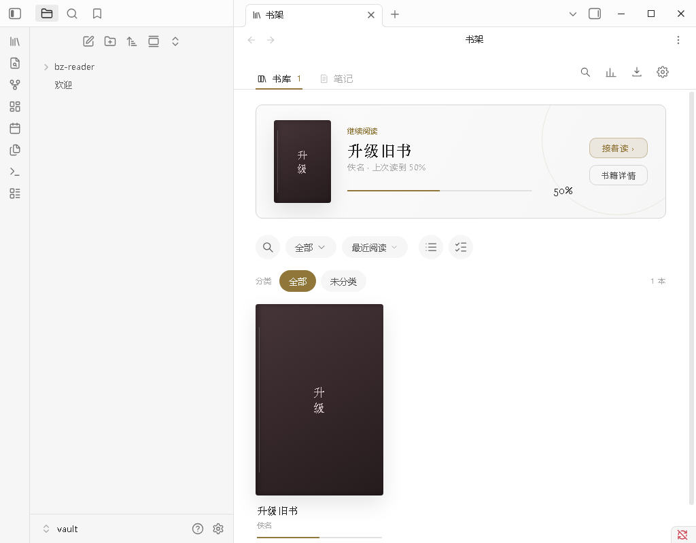
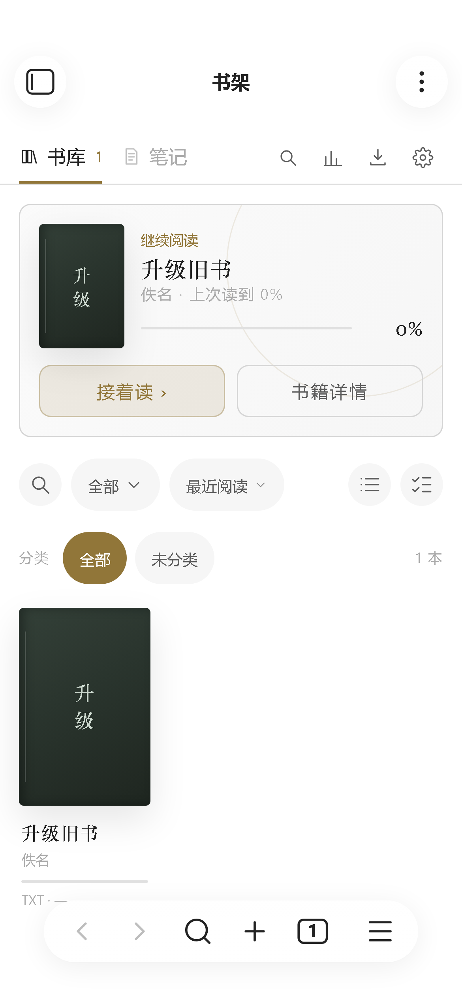
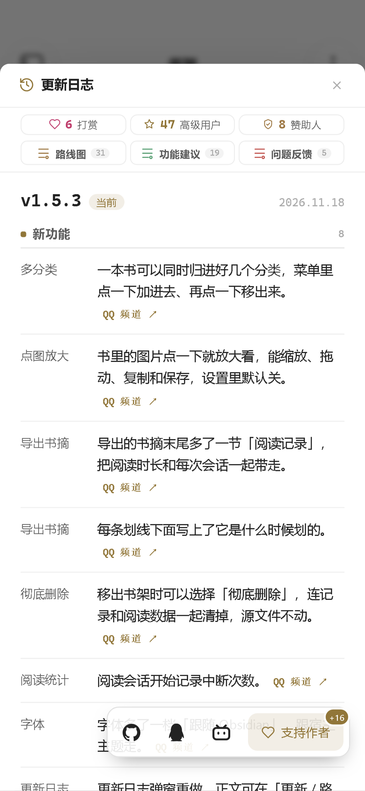

# 全书指纹 v2 真机验证报告（2026-11-21）

## 改了什么

1. **指纹算法 v1 → v2**：从「头尾各 64KB 的 FNV」换成**整本书 SHA-256**，版本 `v2-<sha256 hex>-<字节数>`。中间改一个字节也能认出来（v1 的已知边界消除）。实测 82MB 约 60ms，原生 `crypto.subtle` 异步不挡主线程；桌面手机同一套算法。
2. **取消 64MB 上限**：所有书都算指纹，包括以前被跳过的超大书。
3. **同路径不同指纹 = 换版本**：旧书归档（数据全留、能从归档找回），新书另起一本从零开始，进度划线不再串到新版本上。
4. **后台升级 v1 → v2**：启动、手动同步、打开导入面板三处各触发一次，逐本串行重算，成功才替换、失败保留旧值下次再试，一次升级完统一写盘。

## 门禁

- `tsc --noEmit`：通过
- `vitest run`：360 文件 / 4051 测试全绿（新增 17 条：指纹 v2、升级闸门、换版本、后台升级、归档书跳过）
- `esbuild once`：通过

## Code Review 发现并修复的问题

用 `code-review` skill 跑了 Standards / Spec 双轴审查，发现一个**真实的数据串线 bug**，已修复并补回归测试：

- **归档书被升级导致指纹串线**：换版本后，归档旧书与在架新书指向同一路径（文件已是新版本内容）。原来的升级逻辑会把两本都按当前路径重算成同一个 v2 指纹，此后按指纹查重 / 重新导入 revive 时，旧书的进度划线会串回新书。修复：`upgradeFingerprints()` 跳过 `archivedAt` 书，归档指纹留旧值（代表它自己那版内容）。回归测试：`tests/fingerprint-upgrade.test.ts`「归档书不参与升级」。实测严格场景里 archivedOld 指纹保持 `v1-archived-old-fingerprint`、进度 0.9、划线 1 条完整。

审查其余提示的判断：`ensure` 读指纹失败保留旧书进度是有意的保守设计（无法判断时保数据，不删进度）；`byPath` 回退归档书用于「重新导入复活」，且我的改动已让它优先返回在架书，风险反而降低；测试断言与文件归属的 smell 已顺手收敛。

## 真机验证（独立验证库 + 真 Obsidian 进程）

### 场景一：老用户 v1 指纹升级成 v2，进度保留

构造一本「升级旧书」：带 v1 指纹 `v1-0123456789abcdef01234567`、进度 50%，文件真实存在。重载插件触发启动升级后：

- 指纹被替换为 `v2-08ca5d5dbfd2aae9cf5d035cf27b4d21b209e6394bb2d5f1b96259d2a5f28d34-364`（全书 SHA-256 + 大小）
- 进度仍是 **50%**，书在架上正常显示

桌面端：

移动端（390×844@3x）：

### 场景二：同路径换版本 = 不同的书

在真实 repo 上对已升级的书用同路径、不同指纹调 `ensure()`：

- 旧书 `upgrade-test-book` 被归档（archivedAt 是数字）
- 新书 `b1rfhwsm` 另起、在架，进度从 0% 开始
- `recent()` 只返回新书；书架上只显示新书（0%）

### 场景三：严格数据安全测试（6 本混合数据 + 幂等性）

构造 6 本的老用户库，覆盖升级的所有数据风险分支，重载后逐本核对数据文件：

| 书 | 场景 | 期望 | 实测结果 |
|---|---|---|---|
| oldA | v1 + 文件在 + 进度 50% + 划线 1 条 | 升 v2，进度划线保留 | v2、0.5、划线 1 条 ✅ |
| oldB | v1 + 文件已丢 | 保留 v1 原值 | v1 原值 ✅ |
| curC | 已是 v2 | 跳过不动 | v2 原值 ✅ |
| bigD | v1 + **82MB PDF** | 升 v2（取消上限）、不 OOM | v2、进度 0.2 ✅ |
| archivedOld | v1 + **归档** + 与在架新书同路径 | 跳过（防串线）、进度划线保留 | v1 原值、0.9、划线 1 条 ✅ |
| liveNew | v2 + 在架 + 同路径 | 不动 | v2 原值 ✅ |

- **幂等性**：再次重载，书数量仍 6 本、所有指纹与进度一字不变（已 v2 的跳过、丢文件的保留 v1、归档的保留 v1）。
- **移动端**：切 390×844@3x 布局后重置 bigD 指纹重载，82MB 书同样成功升 v2、进度 0.2 保留。

## 边界与取舍（如实说明）

- **升级那一刻若用户正好换了同名文件的内容**：升级会把当前内容算成 v2 并替换旧指纹，进度会跟过去。升级是一次性迁移窗口，这个叠加场景概率极低；换版本识别主要靠后续导入/同步走 `ensure()`。
- **手机端 64MB 以上书**：算法本身支持（实测桌面 82MB 约 60ms），手机读超大文件进内存仍有 OOM 风险；串行逐本 + 读失败跳过 + 保留旧值，把风险挡在「不动用户数据」之外。

## 状态

改动在 worktree `feat/full-book-fingerprint`，**只过了三道门与独立验证库真机验证，未部署测试库、未合并 master**，等明确指令再合并。
